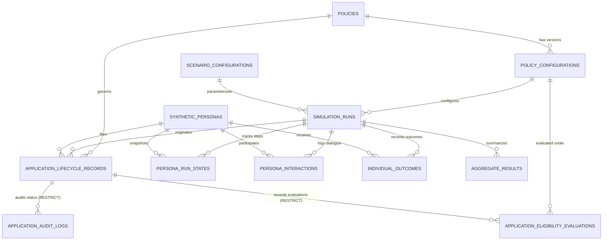
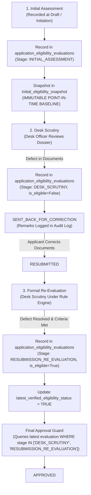
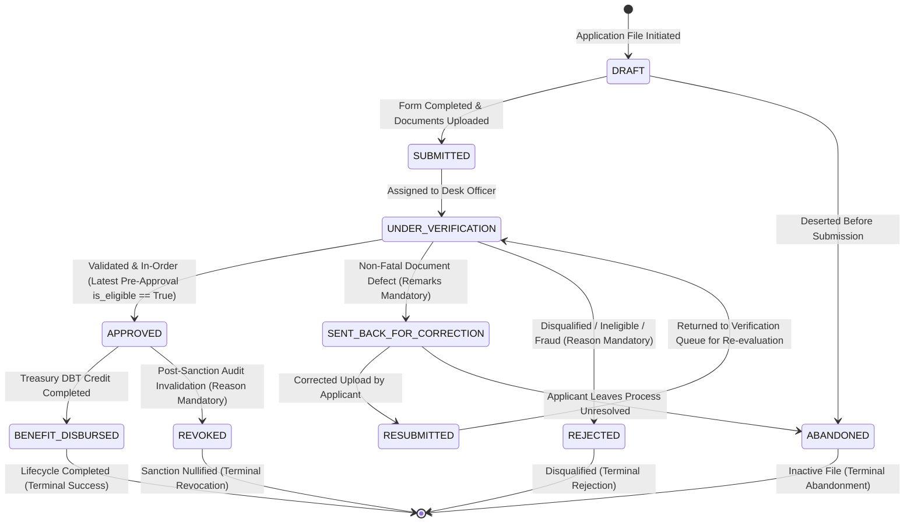

# Database Schema and Application Lifecycle Specification

**Project:** Maharashtra Policy Simulator  
**Module:** Database Foundation & Student Application Lifecycle  
**Author:** Diya  
**Date:** 2026-11-20  
**Version:** 1.4.0 (Final Approved Specification)

---

## 1. Architectural Principles & Boundary Separation

### 1.1 Separation of Concerns
1. **Behavioral Journey vs. Administrative Lifecycle:**
   * **Citizen Behavioral State (`SimulationState`):** In-memory cognitive/behavioral progression (`UNINFORMED`, `AWARE`, `EVALUATING`, `COLLECTING_DOCUMENTS`, `APPLIED`, `BENEFIT_RECEIVED`, `REJECTED`, `DROPPED_OUT`). This models a simulated citizen persona's personal thoughts, peer interactions, and choices during a simulation run.
   * **Administrative Application Status (`ApplicationLifecycleStatus`):** Official institutional processing of a formal scholarship file (`DRAFT`, `SUBMITTED`, `UNDER_VERIFICATION`, `SENT_BACK_FOR_CORRECTION`, `RESUBMITTED`, `APPROVED`, `BENEFIT_DISBURSED`, `REJECTED`, `REVOKED`, `ABANDONED`).
   * **Key Separation Rule:** An official application record is **only created** when an eligible or interested persona initiates a formal application. Personas who remain uninformed, evaluate and decline, or drop out prior to application initiation do **not** have records in the administrative lifecycle tables.
2. **Model Layer Separation:**
   * **Pydantic Schemas (`backend/models.py`):** Used strictly for API request validation and JSON serialization between the backend and frontend.
   * **SQLAlchemy ORM Models (`backend/db_models.py`):** Used strictly for SQLite relational persistence.
   * **Python Dataclasses (`simulation/persona.py`, `simulation/engine.py`):** Lightweight in-memory simulation domain models.
3. **Deterministic Authority:**
   * No LLM output may directly alter official application statuses, eligibility decisions, or financial relief figures. All transitions and benefit calculations are strictly enforced by deterministic Python validation rules.

---

## 2. Policy Accuracy, Scheme-Specific Configurations & Verification Defaults

> [!IMPORTANT]
> **Policy Accuracy Notice:** Eligibility criteria—such as household income limits, attendance thresholds, fee reimbursement fractions, and family beneficiary caps—are **scheme-specific parameters**.
>
> **These values must NEVER be assumed or hardcoded as universal rules across all government schemes.** For example, the ₹8 lakh income cap, 75% attendance threshold, 50% tuition fee reimbursement, and 2-sibling maximum are illustrative parameters specific to the *Rajarshi Chhatrapati Shahu Maharaj Shikshan Shulk Shishyavrutti Yojna (EBC)* higher education scheme. Other schemes (e.g., Post-Matric SC/ST scholarships, Minority scholarships, OBC freeships, or hostel allowances) have fundamentally different eligibility parameters, benefit calculations, and family limits.

### 2.1 Scheme-Specific Configuration & Nullable Rule Parameters
To prevent imposing one scheme's rules onto another:
1. Standard eligibility parameters in `policy_configurations` (`max_income_limit`, `min_attendance_pct`, `baseline_relief_rate`, `max_family_beneficiaries`) are **nullable**. A scheme that does not evaluate attendance (or family sibling caps) leaves those fields `NULL`.
2. A generic `scheme_rules_json` (`TEXT`, nullable) column is provided to hold arbitrary, scheme-specific rule parameters (e.g., qualifying entrance exam percentiles, hostel allowance scales, maintenance fees) validated by deterministic Python rule engines.

### 2.2 Statutory Verification Default
* The column `is_verified_statutory_rule` has an explicit default of **`0` (`False`)**.
* A policy configuration record must **never** be automatically marked as legally verified unless it has been explicitly cross-checked and verified against its official Government Resolution (GR), Gazette, or departmental notification cited in `policy_source_reference`.
* Configurations with `is_verified_statutory_rule = 0` are treated as **illustrative modeling parameters** for simulation and must never be presented as verified government policy.

---

## 3. Simulation Reproducibility Requirements

Deterministic reproducibility in an agent-based simulation cannot be achieved by a random seed alone. The database must record the complete execution context. Every simulation run record in `simulation_runs` must preserve:

1. **Random Seed:** The integer seed (`random_seed`) used by pseudo-random number generators.
2. **Population Parameters:** Configuration identifier (`population_config_name`, e.g., `Dhule-Empirical-2010-11`), demographic dataset checksum (`population_data_version`), and cohort population size (`population_size`).
3. **Policy & Rule Versions:** The exact policy identifier (`policy_id`), policy configuration version (`policy_config_id`), and scenario configuration version (`scenario_config_id`).
4. **Software & Environment Versions:** The application release version or Git commit SHA (`software_version`) and runtime environment configuration.
5. **AI Model & Prompt Specifications:** The exact model identifier (`llm_provider` / `model_version`, e.g., `gemini-3.1-flash-lite@2026` or `offline-stub-v1`) and prompt template version (`prompt_version`), ensuring qualitative reasoning prompts can be reproduced without drift.
6. **Execution Timestamps & Status:** Execution start timestamp (`execution_timestamp`), completion timestamp (`completion_timestamp`), and terminal status (`run_status`).

---

## 4. Complete Database Schema (10 Entities + Supporting Audit & Evaluation Tables)

All tables use SQLite-compatible column types: `INTEGER`, `VARCHAR`, `FLOAT`, `BOOLEAN`, `DATETIME`, and `TEXT`.



---

### Entity 1: Policies / Schemes (`policies`)
* **Purpose:** Catalog of official Maharashtra government welfare and education schemes modeled in the simulator.
* **Table Name:** `policies`
* **Primary Key:** `id` (`INTEGER`, autoincrement)
* **Foreign Keys:** None
* **Relationships:**
  * One-to-Many with `policy_configurations` (`configurations`)
  * One-to-Many with `application_lifecycle_records` (`applications`)
* **Columns:**

| Column Name | Data Type | Constraint | Required/Optional | Description |
| :--- | :--- | :--- | :--- | :--- |
| `id` | `INTEGER` | PK, Autoincrement | Required | Surrogate policy ID |
| `scheme_code` | `VARCHAR(50)` | UNIQUE, Indexed | Required | Unique administrative code (e.g., `RCSMS-EBC`) |
| `scheme_name` | `VARCHAR(255)` | NOT NULL | Required | Official scheme title (e.g., *Rajarshi Chhatrapati Shahu Maharaj...*) |
| `department` | `VARCHAR(255)` | NOT NULL | Required | Nodal ministry/department |
| `target_beneficiary`| `VARCHAR(255)` | NOT NULL | Required | Beneficiary category (e.g., *EBC College Students*) |
| `official_portal_url`| `VARCHAR(255)`| Nullable | Optional | Official portal (e.g., MahaDBT portal scheme link) |
| `description` | `TEXT` | Nullable | Optional | Summary of scheme statutory rules and scope |
| `is_active` | `BOOLEAN` | DEFAULT `1` | Required | Active status flag for simulation availability |
| `created_at` | `DATETIME` | UTC Timestamp | Required | Record creation timestamp |

---

### Entity 2: Policy Configurations (`policy_configurations`)
* **Purpose:** Versioned statutory eligibility parameters and financial relief rules for each scheme. Parameters are scheme-specific and verified against official Government Resolutions (GRs).
* **Table Name:** `policy_configurations`
* **Primary Key:** `id` (`INTEGER`, autoincrement)
* **Foreign Keys:** `policy_id` $\to$ `policies.id` (ON DELETE RESTRICT)
* **Unique Constraints:** `UNIQUE(policy_id, config_version)` — Prevents duplicate configuration versions for the same policy.
* **Relationships:**
  * Many-to-One with `policies`
  * One-to-Many with `simulation_runs`
  * One-to-Many with `application_lifecycle_records`
  * One-to-Many with `application_eligibility_evaluations`
* **Columns:**

| Column Name | Data Type | Constraint | Required/Optional | Description |
| :--- | :--- | :--- | :--- | :--- |
| `id` | `INTEGER` | PK, Autoincrement | Required | Primary key |
| `policy_id` | `INTEGER` | FK (`policies.id`), NOT NULL | Required | Associated policy scheme |
| `config_version` | `VARCHAR(50)` | NOT NULL | Required | Version tag (e.g., `v2024.1-baseline`) |
| `policy_source_reference`| `VARCHAR(255)`| NOT NULL | Required | Official reference (e.g., *GR No. TEM-2018/CR-123/TE-4*) |
| `max_income_limit` | `FLOAT` | Nullable | Optional | Scheme-specific income ceiling in INR (NULL if no income test) |
| `min_attendance_pct`| `FLOAT` | Nullable | Optional | Scheme-specific attendance minimum (NULL if not evaluated) |
| `baseline_relief_rate`| `FLOAT`| Nullable | Optional | Scheme-specific reimbursement rate (NULL if fixed grant) |
| `max_family_beneficiaries`| `INTEGER`| Nullable | Optional | Sibling limit for scheme (NULL if unrestricted) |
| `allows_concurrent_scholarship`| `BOOLEAN`| DEFAULT `0` | Required | Concurrent scholarship policy rule |
| `requires_cap_admission`| `BOOLEAN`| DEFAULT `1` | Required | Mandatory CAP admission rule for professional courses |
| `scheme_rules_json`| `TEXT` | Nullable | Optional | Validated JSON for scheme-specific parameters |
| `is_verified_statutory_rule`| `BOOLEAN`| DEFAULT `0` | Required | **0 = Illustrative parameter; 1 = Verified against official GR** |
| `notes` | `TEXT` | Nullable | Optional | Explanatory statutory caveats and legal provisos |
| `created_at` | `DATETIME` | UTC Timestamp | Required | Configuration creation timestamp |

---

### Entity 3: Synthetic Personas (`synthetic_personas`)
* **Purpose:** Persistent catalog of synthetic citizen personas with complete multi-tier attributes.
* **Table Name:** `synthetic_personas`
* **Primary Key:** `persona_id` (`VARCHAR(64)`)
* **Foreign Keys:** None
* **Relationships:**
  * One-to-Many with `persona_run_states`
  * One-to-Many with `individual_outcomes`
  * One-to-Many with `application_lifecycle_records`
* **Columns:**

| Column Name | Data Type | Constraint | Required/Optional | Description |
| :--- | :--- | :--- | :--- | :--- |
| `persona_id` | `VARCHAR(64)` | PK, Indexed | Required | Unique persona identifier (e.g., `DHULE-STU-001`) |
| `name` | `VARCHAR(128)` | NOT NULL | Required | Full synthetic citizen name |
| `gender` | `VARCHAR(32)` | NOT NULL | Required | `Male`, `Female`, `Non-Binary` |
| `age` | `INTEGER` | NOT NULL | Required | Age in years |
| `district` | `VARCHAR(100)` | NOT NULL, Indexed | Required | Home district (e.g., `Dhule`) |
| `taluka` | `VARCHAR(100)` | NOT NULL | Required | Sub-district administrative division |
| `is_maharashtra_domicile`| `BOOLEAN`| NOT NULL | Required | Statutory Maharashtra domicile status |
| `caste_category` | `VARCHAR(50)` | NOT NULL | Required | Social reservation category (`General-EBC`, `OBC`, etc.) |
| `family_income` | `FLOAT` | NOT NULL | Required | Annual household income in INR |
| `first_generation_learner`| `BOOLEAN`| NOT NULL | Required | First in family to pursue higher education |
| `parental_education_level`| `VARCHAR(50)`| NOT NULL | Required | `None`, `Primary`, `Secondary`, `Graduate` |
| `course_name` | `VARCHAR(150)` | NOT NULL | Required | Degree program enrolled in |
| `course_level` | `VARCHAR(50)` | NOT NULL | Required | `Undergraduate`, `Postgraduate`, `Diploma` |
| `is_professional_course`| `BOOLEAN`| NOT NULL | Required | Professional stream vs general stream |
| `institution_type` | `VARCHAR(50)` | NOT NULL | Required | `Government`, `Government-Aided`, `Private-Unaided` |
| `admission_mode` | `VARCHAR(50)` | NOT NULL | Required | `CAP`, `Management-Quota`, `Institute-Level` |
| `annual_tuition_fee`| `FLOAT` | NOT NULL | Required | College tuition fee in INR |
| `attendance_percentage`| `FLOAT` | NOT NULL | Required | Verified attendance percentage (0.0 to 100.0) |
| `previous_year_passed`| `BOOLEAN` | NOT NULL | Required | Academic continuation status |
| `previous_year_percentage`| `FLOAT`| NOT NULL | Required | Previous year examination marks |
| `academic_gap_years`| `INTEGER` | NOT NULL | Required | Gap years in education |
| `family_beneficiaries_count`| `INTEGER`| NOT NULL | Required | Siblings already receiving scheme |
| `has_other_scholarship`| `BOOLEAN`| NOT NULL | Required | Concurrent scholarship flag |
| `digital_literacy` | `FLOAT` | NOT NULL | Required | Synthetic capacity (0.0 to 1.0) |
| `initial_awareness` | `FLOAT` | NOT NULL | Required | Baseline scheme knowledge (0.0 to 1.0) |
| `document_readiness`| `FLOAT` | NOT NULL | Required | Readiness with certificates (0.0 to 1.0) |
| `financial_urgency` | `FLOAT` | NOT NULL | Required | Pressure of fee burden (0.0 to 1.0) |
| `peer_network_support`| `FLOAT` | NOT NULL | Required | Senior/peer guidance (0.0 to 1.0) |
| `institutional_trust`| `FLOAT` | NOT NULL | Required | Trust in DBT disbursement timelines (0.0 to 1.0) |
| `personality_traits_json`| `TEXT` | NOT NULL | Required | Validated JSON: patience, diligence, risk aversion, self advocacy |
| `created_at` | `DATETIME` | UTC Timestamp | Required | Timestamp persona was synthesized |

---

### Entity 4: Scenario Configurations (`scenario_configurations`)
* **Purpose:** Parameterizes counterfactual policy experiments and behavioral interventions.
* **Table Name:** `scenario_configurations`
* **Primary Key:** `id` (`INTEGER`, autoincrement)
* **Foreign Keys:** None
* **Relationships:**
  * One-to-Many with `simulation_runs`
* **Columns:**

| Column Name | Data Type | Constraint | Required/Optional | Description |
| :--- | :--- | :--- | :--- | :--- |
| `id` | `INTEGER` | PK, Autoincrement | Required | Primary key |
| `scenario_name` | `VARCHAR(150)` | UNIQUE, NOT NULL | Required | E.g., `Baseline`, `Digital-Assistance-Drive` |
| `description` | `TEXT` | Nullable | Optional | Hypothesis tested by this scenario |
| `awareness_campaign_boost`| `FLOAT`| DEFAULT `0.0` | Required | Experimental awareness delta injected per step |
| `document_helpdesk_boost`| `FLOAT` | DEFAULT `0.0` | Required | Experimental document readiness boost |
| `income_cap_override`| `FLOAT` | Nullable | Optional | Experimental income cap test |
| `attendance_threshold_override`| `FLOAT`| Nullable | Optional | Experimental attendance threshold test |
| `created_at` | `DATETIME` | UTC Timestamp | Required | Scenario creation timestamp |

---

### Entity 5: Simulation Runs (`simulation_runs`)
* **Purpose:** Complete audit log of every executed simulation run, storing all parameters required for full reproducibility.
* **Table Name:** `simulation_runs`
* **Primary Key:** `run_id` (`VARCHAR(36)`, UUID)
* **Foreign Keys:**
  * `policy_id` $\to$ `policies.id` (ON DELETE RESTRICT)
  * `policy_config_id` $\to$ `policy_configurations.id` (ON DELETE RESTRICT)
  * `scenario_config_id` $\to$ `scenario_configurations.id` (ON DELETE SET NULL)
* **Consistency Rule:** Application/persistence logic must deterministically validate that `simulation_runs.policy_id == policy_configurations.policy_id`.
* **Relationships:**
  * One-to-Many with `persona_run_states`
  * One-to-Many with `persona_interactions`
  * One-to-Many with `individual_outcomes`
  * One-to-Many with `aggregate_results`
  * One-to-Many with `application_lifecycle_records`
* **Columns (Mandated Reproducibility Fields):**

| Column Name | Data Type | Constraint | Required/Optional | Description |
| :--- | :--- | :--- | :--- | :--- |
| `run_id` | `VARCHAR(36)` | PK, Indexed | Required | Unique UUID string |
| `policy_id` | `INTEGER` | FK (`policies.id`), NOT NULL | Required | Policy scheme simulated |
| `policy_config_id` | `INTEGER` | FK (`policy_configurations.id`), NOT NULL | Required | Exact policy rules version used |
| `scenario_config_id`| `INTEGER`| FK (`scenario_configurations.id`), Nullable | Optional | Counterfactual scenario used (Null if baseline) |
| `population_config_name`| `VARCHAR(100)`| NOT NULL | Required | Population configuration (e.g., `Dhule-2010-11`) |
| `population_data_version`| `VARCHAR(50)`| NOT NULL | Required | Data adapter/census table version or checksum |
| `software_version` | `VARCHAR(50)` | NOT NULL | Required | Codebase release tag or Git commit SHA |
| `prompt_version` | `VARCHAR(50)` | NOT NULL | Required | Version tag of AI persona prompt template |
| `district` | `VARCHAR(100)` | NOT NULL | Required | Demographic district baseline |
| `population_size` | `INTEGER` | NOT NULL | Required | Population size simulated |
| `random_seed` | `INTEGER` | NOT NULL | Required | Seed for deterministic pseudo-random sequence |
| `simulation_steps` | `INTEGER` | NOT NULL | Required | Sequential rounds executed |
| `llm_provider` | `VARCHAR(100)` | NOT NULL | Required | Provider tag (`Offline-Stub` or `Gemini-3.1-Flash-Lite`) |
| `model_version` | `VARCHAR(100)` | NOT NULL | Required | Exact AI model version (e.g., `gemini-3.1-flash-lite@latest` or `stub-v1`) |
| `execution_timestamp`| `DATETIME` | NOT NULL, Indexed | Required | Execution start timestamp |
| `completion_timestamp`| `DATETIME`| Nullable | Optional | Run finish timestamp |
| `run_status` | `VARCHAR(32)` | NOT NULL | Required | Execution status (`PENDING`, `RUNNING`, `COMPLETED`, `FAILED`) |
| `status_message` | `TEXT` | Nullable | Optional | Error trace or execution summary notes |

---

### Entity 6: Persona States per Run (`persona_run_states`)
* **Purpose:** Stores the temporal state snapshot of each persona at each simulation step round.
* **Table Name:** `persona_run_states`
* **Primary Key:** `id` (`INTEGER`, autoincrement)
* **Foreign Keys:**
  * `run_id` $\to$ `simulation_runs.run_id` (ON DELETE CASCADE)
  * `persona_id` $\to$ `synthetic_personas.persona_id` (ON DELETE CASCADE)
* **Unique Constraints:** `UNIQUE(run_id, persona_id, step_number)` — Prevents duplicate snapshots for a persona in the same step.
* **Columns:**

| Column Name | Data Type | Constraint | Required/Optional | Description |
| :--- | :--- | :--- | :--- | :--- |
| `id` | `INTEGER` | PK, Autoincrement | Required | Primary key |
| `run_id` | `VARCHAR(36)` | FK (`simulation_runs.run_id`), NOT NULL | Required | Associated simulation run |
| `persona_id` | `VARCHAR(64)` | FK (`synthetic_personas.persona_id`), NOT NULL | Required | Evaluated persona ID |
| `step_number` | `INTEGER` | NOT NULL | Required | Discrete simulation step (1 to N) |
| `awareness_score` | `FLOAT` | NOT NULL | Required | Awareness at this step (0.0 to 1.0) |
| `trust_score` | `FLOAT` | NOT NULL | Required | Institutional trust at this step (0.0 to 1.0) |
| `document_readiness_score`| `FLOAT`| NOT NULL | Required | Document readiness at this step (0.0 to 1.0) |
| `peer_network_support`| `FLOAT` | NOT NULL | Required | Peer support at this step (0.0 to 1.0) |
| `application_probability`| `FLOAT` | NOT NULL | Required | Probability of initiating application |
| `completion_probability` | `FLOAT` | NOT NULL | Required | Probability of completing application |
| `expected_uptake_probability`| `FLOAT`| NOT NULL | Required | Net mathematical uptake probability |
| `simulation_state` | `VARCHAR(50)` | NOT NULL | Required | In-memory cognitive state (`AWARE`, `EVALUATING`, etc.) |
| `recorded_at` | `DATETIME` | UTC Timestamp | Required | Snapshot timestamp |

---

### Entity 7: Interactions (`persona_interactions`)
* **Purpose:** Logs word-of-mouth dialogues and state diffusion across the social graph.
* **Table Name:** `persona_interactions`
* **Primary Key:** `id` (`INTEGER`, autoincrement)
* **Foreign Keys:**
  * `run_id` $\to$ `simulation_runs.run_id` (ON DELETE CASCADE)
  * `sender_id` $\to$ `synthetic_personas.persona_id` (ON DELETE CASCADE)
  * `receiver_id` $\to$ `synthetic_personas.persona_id` (ON DELETE CASCADE)
* **Columns:**

| Column Name | Data Type | Constraint | Required/Optional | Description |
| :--- | :--- | :--- | :--- | :--- |
| `id` | `INTEGER` | PK, Autoincrement | Required | Primary key |
| `run_id` | `VARCHAR(36)` | FK (`simulation_runs.run_id`), NOT NULL | Required | Associated simulation run |
| `step_number` | `INTEGER` | NOT NULL | Required | Step round in which dialogue occurred |
| `sender_id` | `VARCHAR(64)` | FK (`synthetic_personas.persona_id`), NOT NULL | Required | Persona initiating interaction |
| `receiver_id` | `VARCHAR(64)` | FK (`synthetic_personas.persona_id`), NOT NULL | Required | Persona receiving interaction |
| `interaction_topic`| `VARCHAR(100)`| NOT NULL | Required | Topic (`SCHEME_AWARENESS`, `DOCUMENT_HELP`, etc.) |
| `sender_message` | `TEXT` | NOT NULL | Required | Conversational dialogue spoken by sender |
| `receiver_response`| `TEXT` | NOT NULL | Required | Conversational response spoken by receiver |
| `state_changed` | `BOOLEAN` | NOT NULL | Required | Flag indicating if receiver's state updated |
| `state_changes_json`| `TEXT` | Nullable | Optional | Validated JSON string of state deltas applied |
| `occurred_at` | `DATETIME` | UTC Timestamp | Required | Interaction timestamp |

---

### Entity 8: Individual Outcomes (`individual_outcomes`)
* **Purpose:** Stores the final policy evaluation, realization outcome, and AI monologue for each persona in a run.
* **Table Name:** `individual_outcomes`
* **Primary Key:** `id` (`INTEGER`, autoincrement)
* **Foreign Keys:**
  * `run_id` $\to$ `simulation_runs.run_id` (ON DELETE CASCADE)
  * `persona_id` $\to$ `synthetic_personas.persona_id` (ON DELETE CASCADE)
* **Unique Constraints:** `UNIQUE(run_id, persona_id)` — Prevents duplicate outcome records for the same persona in a single run.
* **Columns:**

| Column Name | Data Type | Constraint | Required/Optional | Description |
| :--- | :--- | :--- | :--- | :--- |
| `id` | `INTEGER` | PK, Autoincrement | Required | Primary key |
| `run_id` | `VARCHAR(36)` | FK (`simulation_runs.run_id`), NOT NULL | Required | Associated simulation run |
| `persona_id` | `VARCHAR(64)` | FK (`synthetic_personas.persona_id`), NOT NULL | Required | Persona evaluated |
| `is_statutorily_eligible`| `BOOLEAN`| NOT NULL | Required | Statutory eligibility outcome |
| `estimated_fee_relief_inr`| `FLOAT`| NOT NULL | Required | Calculated relief amount in INR |
| `statutory_failure_reasons_json`| `TEXT`| Nullable | Optional | Validated JSON list of rule violation notes |
| `final_simulation_state`| `VARCHAR(50)`| NOT NULL | Required | Cognitive end state (`BENEFIT_RECEIVED`, etc.) |
| `attempted_application`| `BOOLEAN` | NOT NULL | Required | Whether persona decided to apply |
| `completed_application`| `BOOLEAN` | NOT NULL | Required | Whether persona submitted application |
| `benefit_received` | `BOOLEAN` | NOT NULL | Required | Whether benefit was realized |
| `inner_monologue` | `TEXT` | NOT NULL | Required | AI persona qualitative self-talk |
| `stated_intention` | `VARCHAR(255)` | NOT NULL | Required | Persona stated intent |
| `perceived_barriers_json`| `TEXT` | Nullable | Optional | Validated JSON list of barriers |
| `chosen_action` | `VARCHAR(100)` | NOT NULL | Required | Chosen next action |
| `confidence_level` | `VARCHAR(50)` | NOT NULL | Required | High, Moderate, or Low |

---

### Entity 9: Aggregate Results (`aggregate_results`)
* **Purpose:** Stores macro-level cohort outcomes per run (and per step) for dashboards and KPI reporting.
* **Table Name:** `aggregate_results`
* **Primary Key:** `id` (`INTEGER`, autoincrement)
* **Foreign Keys:** `run_id` $\to$ `simulation_runs.run_id` (ON DELETE CASCADE)
* **Unique Constraints:** `UNIQUE(run_id, step_number)` — Exactly one aggregate snapshot per step per run (step 0 = final cohort aggregate).
* **Columns:**

| Column Name | Data Type | Constraint | Required/Optional | Description |
| :--- | :--- | :--- | :--- | :--- |
| `id` | `INTEGER` | PK, Autoincrement | Required | Primary key |
| `run_id` | `VARCHAR(36)` | FK (`simulation_runs.run_id`), NOT NULL | Required | Associated simulation run |
| `step_number` | `INTEGER` | NOT NULL (0 = final cohort aggregate)| Required | Snapshot step |
| `total_personas` | `INTEGER` | NOT NULL | Required | Population simulated |
| `eligible_count` | `INTEGER` | NOT NULL | Required | Count of eligible students |
| `ineligible_count` | `INTEGER` | NOT NULL | Required | Count of ineligible students |
| `eligibility_rate` | `FLOAT` | NOT NULL | Required | Eligibility rate (0.0 to 1.0) |
| `mean_awareness` | `FLOAT` | NOT NULL | Required | Average awareness |
| `mean_perceived_benefit`| `FLOAT` | NOT NULL | Required | Average perceived benefit |
| `mean_application_probability`| `FLOAT`| NOT NULL | Required | Average application probability |
| `expected_uptake_probability`| `FLOAT`| NOT NULL | Required | Macro expected uptake probability |
| `realized_uptake_count`| `INTEGER`| NOT NULL | Required | Realized uptake count |
| `realized_uptake_rate`| `FLOAT` | NOT NULL | Required | Realized uptake rate |
| `total_fee_relief_inr`| `FLOAT` | NOT NULL | Required | Total fee relief in INR |
| `avg_relief_per_eligible_inr`| `FLOAT`| NOT NULL | Required | Average relief per eligible student |
| `categorical_breakdowns_json`| `TEXT`| Nullable | Optional | Validated JSON string of demographic breakdowns |

---

### Entity 10: Application Lifecycle Records (`application_lifecycle_records`)
* **Purpose:** Formal administrative record tracking student scholarship application files. Only created when a citizen starts an official application. Preserves an **immutable initial statutory eligibility snapshot** while linking to full historical evaluation and status audit records.
* **Table Name:** `application_lifecycle_records`
* **Primary Key:** `id` (`INTEGER`, autoincrement)
* **Foreign Keys:**
  * `persona_id` $\to$ `synthetic_personas.persona_id` (ON DELETE RESTRICT)
  * `policy_id` $\to$ `policies.id` (ON DELETE RESTRICT)
  * `evaluation_policy_config_id` $\to$ `policy_configurations.id` (ON DELETE RESTRICT)
  * `latest_verification_policy_config_id` $\to$ `policy_configurations.id` (ON DELETE RESTRICT)
  * `run_id` $\to$ `simulation_runs.run_id` (ON DELETE SET NULL)
* **Consistency Rules:**
  * `application_lifecycle_records.policy_id == policy_configurations(evaluation_policy_config_id).policy_id`.
  * `application_lifecycle_records.policy_id == policy_configurations(latest_verification_policy_config_id).policy_id` (when verified).
* **Relationships:**
  * One-to-Many with `application_audit_logs` (`audit_history`)
  * One-to-Many with `application_eligibility_evaluations` (`evaluation_history`)
* **Hard-Deletion Prohibition:** Application records with associated audit logs or eligibility evaluation history **must NOT be hard-deleted**. Foreign key `ON DELETE RESTRICT` constraints on child tables enforce this requirement.
* **Columns:**

| Column Name | Data Type | Constraint | Required/Optional | Description |
| :--- | :--- | :--- | :--- | :--- |
| `id` | `INTEGER` | PK, Autoincrement | Required | Surrogate key |
| `application_number` | `VARCHAR(50)` | UNIQUE, Indexed | Required | Official ID (e.g., `MHD-2026-RCSMS-00001`) |
| `persona_id` | `VARCHAR(64)` | FK (`synthetic_personas.persona_id`), NOT NULL | Required | Applicant citizen ID |
| `policy_id` | `INTEGER` | FK (`policies.id`), NOT NULL | Required | Scheme applied for |
| `evaluation_policy_config_id`| `INTEGER`| FK (`policy_configurations.id`), NOT NULL | Required | Policy rules version used for initial assessment |
| `run_id` | `VARCHAR(36)` | FK (`simulation_runs.run_id`), Nullable | Optional | Simulation run origin (if generated by run) |
| `current_status` | `VARCHAR(50)` | NOT NULL, Indexed | Required | Current administrative lifecycle status |
| `initial_eligibility_snapshot`| `BOOLEAN`| NOT NULL | Required | **Immutable snapshot of eligibility evaluated at application creation** |
| `initial_ineligibility_reasons_json`| `TEXT`| Nullable | Optional | **Immutable snapshot of failure reasons at evaluation time** |
| `evaluated_at` | `DATETIME` | NOT NULL | Required | **Exact timestamp when initial evaluation was recorded** |
| `latest_verified_eligibility_status`| `BOOLEAN`| Nullable | Optional | **Most recent verified eligibility result from pre-approval scrutiny** |
| `latest_verification_policy_config_id`| `INTEGER`| FK (`policy_configurations.id`), Nullable | Optional | Policy config used for latest formal pre-approval verification |
| `latest_verification_timestamp`| `DATETIME`| Nullable | Optional | **Timestamp of latest formal pre-approval scrutiny event** |
| `claimed_fee_relief_inr`| `FLOAT` | NOT NULL | Required | Fee relief claimed by student |
| `approved_fee_relief_inr`| `FLOAT`| DEFAULT `0.0` | Required | Amount officially sanctioned |
| `disbursed_amount_inr`| `FLOAT` | DEFAULT `0.0` | Required | Amount credited via DBT |
| `submission_timestamp`| `DATETIME` | Nullable | Optional | Timestamp when submitted |
| `scrutiny_timestamp` | `DATETIME` | Nullable | Optional | Timestamp when desk scrutiny occurred |
| `approval_timestamp` | `DATETIME` | Nullable | Optional | Timestamp when sanctioned |
| `disbursement_timestamp`| `DATETIME`| Nullable | Optional | Timestamp when DBT credit completed |
| `rejection_timestamp`| `DATETIME` | Nullable | Optional | Timestamp when rejected |
| `revocation_timestamp`| `DATETIME`| Nullable | Optional | Timestamp when sanction revoked post-approval |
| `abandoned_timestamp`| `DATETIME` | Nullable | Optional | Timestamp when application abandoned |
| `created_at` | `DATETIME` | UTC Timestamp | Required | Application file creation timestamp |
| `updated_at` | `DATETIME` | UTC Timestamp | Required | Last state change timestamp |

---

### Supporting Table 1: `application_eligibility_evaluations` (Evaluation History)
* **Purpose:** Preserves the complete, immutable historical audit trail of **every eligibility evaluation event** conducted on an application file across its lifecycle (initial assessment at initiation, desk scrutiny assessment, re-evaluation upon resubmission, and post-sanction audit). Prevents overwriting previous evaluation history.
* **Table Name:** `application_eligibility_evaluations`
* **Primary Key:** `id` (`INTEGER`, autoincrement)
* **Foreign Keys:**
  * `application_id` $\to$ `application_lifecycle_records.id` (**ON DELETE RESTRICT**) — Strictly preserves evaluation history; prevents deletion of evaluated application files.
  * `policy_config_id` $\to$ `policy_configurations.id` (ON DELETE RESTRICT)
* **Indexes:** `INDEX(application_id, evaluated_at)`, `INDEX(application_id, evaluation_stage)`
* **Columns:**

| Column Name | Data Type | Constraint | Required/Optional | Description |
| :--- | :--- | :--- | :--- | :--- |
| `id` | `INTEGER` | PK, Autoincrement | Required | Primary key |
| `application_id` | `INTEGER` | FK (`application_lifecycle_records.id`), NOT NULL | Required | Application evaluated |
| `evaluation_stage` | `VARCHAR(50)` | NOT NULL | Required | `INITIAL_ASSESSMENT`, `DESK_SCRUTINY`, `RESUBMISSION_RE_EVALUATION`, `POST_SANCTION_AUDIT` |
| `is_eligible` | `BOOLEAN` | NOT NULL | Required | Eligibility result at this evaluation event |
| `failure_reasons_json`| `TEXT` | Nullable | Optional | Validated JSON list of statutory barrier notes |
| `policy_config_id` | `INTEGER` | FK (`policy_configurations.id`), NOT NULL | Required | Policy rules version applied for this evaluation |
| `evaluated_by` | `VARCHAR(50)` | NOT NULL | Required | Actor (`SYSTEM_ENGINE`, `SCRUTINY_OFFICER`, `AUDIT_OFFICER`) |
| `evaluation_notes` | `TEXT` | Nullable | Optional | Narrative explanation or officer assessment notes |
| `evaluated_at` | `DATETIME` | NOT NULL | Required | Exact UTC timestamp when evaluation occurred |

---

### Supporting Table 2: `application_audit_logs` (Status Transition Audit)
* **Purpose:** Strictly **append-only** audit trail recording every administrative lifecycle status change, actor, reason, and timestamp. Existing records must never be modified or deleted. Does not duplicate eligibility evaluation records.
* **Table Name:** `application_audit_logs`
* **Primary Key:** `id` (`INTEGER`, autoincrement)
* **Foreign Keys:**
  * `application_id` $\to$ `application_lifecycle_records.id` (**ON DELETE RESTRICT**) — Strictly preserves audit trail; prevents deletion of audited application files.
* **Columns:**

| Column Name | Data Type | Constraint | Required/Optional | Description |
| :--- | :--- | :--- | :--- | :--- |
| `id` | `INTEGER` | PK, Autoincrement | Required | Primary key |
| `application_id` | `INTEGER` | FK (`application_lifecycle_records.id`), NOT NULL | Required | Application audited |
| `from_status` | `VARCHAR(50)` | NOT NULL | Required | Status before transition |
| `to_status` | `VARCHAR(50)` | NOT NULL | Required | New status after transition |
| `reason_or_remarks`| `TEXT` | Nullable | Optional | Mandatory for rejection, sent-back, revocation, re-evaluation |
| `performed_by` | `VARCHAR(50)` | NOT NULL | Required | Actor (`STUDENT`, `SCRUTINY_OFFICER`, `DISBURSEMENT_OFFICER`, `SYSTEM_ENGINE`) |
| `timestamp` | `DATETIME` | NOT NULL | Required | Exact UTC timestamp of change |

---

## 5. Eligibility Evaluation, Scrutiny Verification & Re-evaluation

A crucial design requirement is reconciling three distinct phases of eligibility assessment while maintaining complete historical integrity:



### 5.1 Three Distinct Evaluation Phases
1. **Initial Eligibility Assessment:**
   * Conducted automatically when the student starts drafting an application.
   * Stamped permanently into `initial_eligibility_snapshot`, `initial_ineligibility_reasons_json`, and `evaluated_at` on `application_lifecycle_records`.
   * Also inserted as the first row in `application_eligibility_evaluations` (`evaluation_stage = 'INITIAL_ASSESSMENT'`).
   * **Rule:** These fields are an **immutable point-in-time record**. They are never modified, even if the student later submits corrections or fixes documentation errors.
2. **Administrative Desk Scrutiny Verification:**
   * Conducted by a desk officer when reviewing uploaded Tahsildar income certificates, CAP admission receipts, and domicile records.
   * A new row is appended to `application_eligibility_evaluations` (`evaluation_stage = 'DESK_SCRUTINY'`).
   * If a document is defective (e.g., expired certificate or missing seal), the officer does **not** reject the student permanently; instead, the status transitions to `SENT_BACK_FOR_CORRECTION` with detailed deficiency remarks.
3. **Formal Re-Evaluation After Correction:**
   * When the applicant rectifies the deficiency and resubmits (`RESUBMITTED`), desk scrutiny executes a **formal re-evaluation**.
   * A new row is appended to `application_eligibility_evaluations` (`evaluation_stage = 'RESUBMISSION_RE_EVALUATION'`).
   * If the corrected evidence demonstrates statutory compliance, the evaluation record is created with `is_eligible = True`, and `latest_verified_eligibility_status` is updated to `True` on the application record.
   * An accompanying entry is written to `application_audit_logs` detailing the status transition.

### 5.2 The Final Approval Guard Rule

> [!IMPORTANT]
> **Approval Guard Verification Logic:**  
> The final approval guard checks the **latest valid, formally verified eligibility assessment from applicable pre-approval stages** (`evaluation_stage` in `['DESK_SCRUTINY', 'RESUBMISSION_RE_EVALUATION']` ordered by `evaluated_at DESC`), NOT the immutable initial snapshot.
>
> If an applicant initially failed due to unverified documentation but subsequently submitted valid Tahsildar certificates during resubmission and was verified as eligible, the approval guard **permits approval**.
>
> Conversely, if the latest verified assessment has `is_eligible == False` (or if no pre-approval verification has occurred and `initial_eligibility_snapshot == False`), any transition to `APPROVED` or `BENEFIT_DISBURSED` is blocked with `IneligibleApprovalViolationError`.

> [!CAUTION]
> **Exclusion of Post-Sanction Audits from Approval Authorization:**  
> Evaluations recorded under `evaluation_stage = 'POST_SANCTION_AUDIT'` **cannot authorize an initial application approval**.
>
> Post-sanction audit assessments exist solely to record subsequent compliance reviews conducted on already-disbursed files (which may trigger a `REVOKED` state if fraudulent or duplicate claims are uncovered post-approval). They must remain append-only historical records and **must not retroactively authorize an approval**.

---

## 6. Student Application Lifecycle State Machine

### 6.1 State Machine Flow Diagram



---

### 6.2 Valid Transitions Table

| Current State | Target State | Condition / Rule | Authorized Actor | Remarks Mandatory? |
| :--- | :--- | :--- | :--- | :--- |
| `DRAFT` | `SUBMITTED` | Required documents uploaded | `STUDENT` | No |
| `DRAFT` | `ABANDONED` | Student deserts draft before filing | `STUDENT` / `SYSTEM_ENGINE` | Optional |
| `SUBMITTED` | `UNDER_VERIFICATION` | Desk officer starts scrutiny | `SCRUTINY_OFFICER` | No |
| `UNDER_VERIFICATION` | `APPROVED` | **Latest pre-approval verified assessment is_eligible == True** | `SCRUTINY_OFFICER` | Yes (Sanction remarks) |
| `UNDER_VERIFICATION` | `SENT_BACK_FOR_CORRECTION` | Non-fatal defect in documentation | `SCRUTINY_OFFICER` | **Yes (Mandatory deficiency note)** |
| `UNDER_VERIFICATION` | `REJECTED` | Statutory ineligibility / fraud | `SCRUTINY_OFFICER` | **Yes (Mandatory rejection reason)** |
| `SENT_BACK_FOR_CORRECTION` | `RESUBMITTED` | Corrected documents provided | `STUDENT` | Yes (Correction summary) |
| `SENT_BACK_FOR_CORRECTION` | `ABANDONED` | Student does not respond to correction | `STUDENT` / `SYSTEM_ENGINE` | Optional |
| `RESUBMITTED` | `UNDER_VERIFICATION` | Returns to scrutiny queue for re-evaluation | `SCRUTINY_OFFICER` | No |
| `APPROVED` | `BENEFIT_DISBURSED` | Treasury DBT transfer cleared | `DISBURSEMENT_OFFICER` | Yes (Disbursement UTR/Ref) |
| `APPROVED` | `REVOKED` | Post-approval audit revocation | `SCRUTINY_OFFICER` | **Yes (Mandatory revocation reason)** |

---

### 6.3 Forbidden State Transitions Table

| Attempted Transition | Reason Forbidden | Error Raised |
| :--- | :--- | :--- |
| `DRAFT` $\to$ `APPROVED` | Cannot bypass submission and scrutiny | `InvalidLifecycleTransitionError` |
| `SUBMITTED` $\to$ `BENEFIT_DISBURSED` | Cannot disburse without formal approval | `InvalidLifecycleTransitionError` |
| `UNDER_VERIFICATION` $\to$ `APPROVED` (When latest verified pre-approval evaluation is False) | Ineligible applicant must never be approved | `IneligibleApprovalViolationError` |
| `REJECTED` $\to$ `APPROVED` | Terminal state cannot be approved | `InvalidLifecycleTransitionError` |
| `REVOKED` $\to$ `BENEFIT_DISBURSED` | Revoked sanction cannot receive funds | `InvalidLifecycleTransitionError` |
| `BENEFIT_DISBURSED` $\to$ `SUBMITTED` | Disbursed file cannot be resubmitted | `InvalidLifecycleTransitionError` |
| `SENT_BACK_FOR_CORRECTION` $\to$ `APPROVED` | Must be resubmitted and verified first | `InvalidLifecycleTransitionError` |
| `UNDER_VERIFICATION` $\to$ `REVOKED` | Can only revoke post-approval; use `REJECTED` | `InvalidLifecycleTransitionError` |
| `APPROVED` $\to$ `REJECTED` | Rejections occur during verification; use `REVOKED` | `InvalidLifecycleTransitionError` |

---

## 7. Audit Trail, History Preservation & SQLite Transactional Compatibility

### 7.1 Append-Only Audit Integrity & Hard-Deletion Prohibition
* Both `application_audit_logs` and `application_eligibility_evaluations` are strictly **append-only**.
* Records must never be edited, overwritten, or deleted by any application workflow.
* Every single lifecycle status transition generates **exactly one** audit record.
* Every evaluation or re-evaluation event generates **exactly one** evaluation history record.
* **Hard-Deletion Prohibition:** Application files with associated audit logs or evaluation history cannot be hard-deleted from the database (`ON DELETE RESTRICT`). They are permanently retained for audit compliance.

### 7.2 SQLite Transaction Semantics (SQLAlchemy 2.x)
In SQLite, concurrency is managed through database-level locks rather than PostgreSQL-style row-level locks (`SELECT ... FOR UPDATE`). Invoking `with_for_update()` in SQLite generates a no-op or error depending on the driver dialect.

To achieve strict atomicity without transaction nesting conflicts:
1. Wrap both the application record update and the audit log insertion inside a single `with session.begin():` block.
2. If any error occurs (validation failure, DB error), the block exits and SQLAlchemy automatically issues a `ROLLBACK`.
3. Under no circumstances may an application status update commit without its audit record, or vice versa.

```python
from datetime import datetime, timezone
from sqlalchemy.orm import Session
from backend.db_models import ApplicationRecordDB, ApplicationAuditLogDB
from backend.lifecycle_service import ApplicationLifecycleStatus, validate_lifecycle_transition

def transition_application_status(
    session: Session,
    application_id: int,
    to_status: ApplicationLifecycleStatus,
    performed_by: str,
    reason: str | None = None,
    disbursed_amount: float | None = None
) -> ApplicationRecordDB:
    """
    Executes an atomic status transition and audit log insertion.
    Fully compatible with SQLite and SQLAlchemy 2.x transaction management.
    """
    # Open an atomic transaction block
    with session.begin():
        # Query the application record
        app = session.query(ApplicationRecordDB).filter_by(id=application_id).one()
        
        # 1. Deterministic validation (raises exception on invalid transition or ineligible approval)
        validate_lifecycle_transition(session, app, to_status, reason)
        
        from_status = app.current_status
        now_utc = datetime.now(timezone.utc)
        
        # 2. Update status and relevant lifecycle timestamp
        app.current_status = to_status.value
        app.updated_at = now_utc
        
        if to_status == ApplicationLifecycleStatus.SUBMITTED:
            app.submission_timestamp = now_utc
        elif to_status == ApplicationLifecycleStatus.UNDER_VERIFICATION:
            app.scrutiny_timestamp = now_utc
        elif to_status == ApplicationLifecycleStatus.APPROVED:
            app.approval_timestamp = now_utc
        elif to_status == ApplicationLifecycleStatus.BENEFIT_DISBURSED:
            app.disbursement_timestamp = now_utc
            if disbursed_amount is not None:
                app.disbursed_amount_inr = disbursed_amount
        elif to_status == ApplicationLifecycleStatus.REJECTED:
            app.rejection_timestamp = now_utc
        elif to_status == ApplicationLifecycleStatus.REVOKED:
            app.revocation_timestamp = now_utc
        elif to_status == ApplicationLifecycleStatus.ABANDONED:
            app.abandoned_timestamp = now_utc

        # 3. Insert append-only audit log in the exact same transaction
        audit_entry = ApplicationAuditLogDB(
            application_id=app.id,
            from_status=from_status,
            to_status=to_status.value,
            reason_or_remarks=reason,
            performed_by=performed_by,
            timestamp=now_utc
        )
        session.add(audit_entry)
        
    # Transaction commits automatically on exiting the 'with session.begin()' context.
    # If any error was raised, rollback is executed automatically.
    return app
```

---

## 8. JSON Validation & Serialization Standards

All database columns ending in `_json` (e.g., `personality_traits_json`, `scheme_rules_json`, `statutory_failure_reasons_json`, `state_changes_json`, `categorical_breakdowns_json`, `failure_reasons_json`) store structured data as SQLite `TEXT`.

To prevent silent corruption:
1. **Pre-Persistence Validation:** Before saving, Python serialization must validate data using Pydantic models or strict `json.dumps()` with standard Python primitives (`dict`, `list`, `str`, `int`, `float`, `bool`).
2. **Post-Retrieval Validation:** Upon retrieval, values must be deserialized with `json.loads()`. If parsing fails, an explicit `DatabaseDataIntegrityError` is raised rather than silently returning corrupted defaults or empty structures.
3. **ORM Helpers:** ORM models will provide type-safe property accessors (e.g., `app.initial_ineligibility_reasons` returning `list[str]`) that handle deserialization and error checking transparently.

---

## 9. Timestamp Consistency & Timezone Standards

All timestamps throughout the Maharashtra Policy Simulator must follow consistent UTC handling:

1. **Python Application Layer:**
   * Generated exclusively using timezone-aware UTC:
     ```python
     from datetime import datetime, timezone
     now_utc = datetime.now(timezone.utc)
     ```
   * Deprecated naive calls (`datetime.now()`, `datetime.utcnow()`) must not be used.
2. **SQLite Storage Layer:**
   * SQLite does not have a native timezone-aware `DATETIME` type.
   * SQLAlchemy handles `DateTime` columns by storing ISO 8601 formatted text strings (`YYYY-MM-DDTHH:MM:SS.ffffff+00:00` or `YYYY-MM-DD HH:MM:SS.ffffff`).
   * On retrieval, SQLAlchemy converts these back to Python `datetime` objects.
   * Tests will verify that retrieved timestamps retain exact UTC temporal values without local system clock offset drift.

---

## 10. Schema Integrity, Constraints & Cardinality Summary

| Table | Constraint Type | Target Columns / Foreign Key | On Delete Action | Purpose |
| :--- | :--- | :--- | :--- | :--- |
| `policies` | Primary Key | `id` | - | Surrogate identifier |
| `policies` | Unique | `scheme_code` | - | Prevent duplicate policy scheme codes |
| `policy_configurations` | Primary Key | `id` | - | Surrogate identifier |
| `policy_configurations` | Foreign Key | `policy_id` $\to$ `policies.id` | `RESTRICT` | Prevent orphaned configuration versions |
| `policy_configurations` | Unique | `(policy_id, config_version)` | - | Exactly one version tag per policy |
| `synthetic_personas` | Primary Key | `persona_id` | - | Natural unique persona identifier |
| `scenario_configurations` | Primary Key | `id` | - | Surrogate identifier |
| `scenario_configurations` | Unique | `scenario_name` | - | Prevent duplicate scenario tags |
| `simulation_runs` | Primary Key | `run_id` | - | Unique execution UUID |
| `simulation_runs` | Foreign Key | `policy_id` $\to$ `policies.id` | `RESTRICT` | Ensure valid policy reference |
| `simulation_runs` | Foreign Key | `policy_config_id` $\to$ `policy_configurations.id` | `RESTRICT` | Ensure valid parameter reference |
| `simulation_runs` | Foreign Key | `scenario_config_id` $\to$ `scenario_configurations.id` | `SET NULL` | Scenario is optional |
| `persona_run_states` | Primary Key | `id` | - | Surrogate identifier |
| `persona_run_states` | Foreign Key | `run_id` $\to$ `simulation_runs.run_id` | `CASCADE` | Delete states when run is cleared |
| `persona_run_states` | Foreign Key | `persona_id` $\to$ `synthetic_personas.persona_id` | `CASCADE` | Delete states when persona is cleared |
| `persona_run_states` | Unique | `(run_id, persona_id, step_number)` | - | **One state snapshot per persona per step** |
| `persona_interactions` | Primary Key | `id` | - | Surrogate identifier |
| `persona_interactions` | Foreign Key | `run_id` $\to$ `simulation_runs.run_id` | `CASCADE` | Delete interactions when run is cleared |
| `persona_interactions` | Foreign Key | `sender_id` $\to$ `synthetic_personas.persona_id` | `CASCADE` | Link sender persona |
| `persona_interactions` | Foreign Key | `receiver_id` $\to$ `synthetic_personas.persona_id` | `CASCADE` | Link receiver persona |
| `individual_outcomes` | Primary Key | `id` | - | Surrogate identifier |
| `individual_outcomes` | Foreign Key | `run_id` $\to$ `simulation_runs.run_id` | `CASCADE` | Delete outcomes when run is cleared |
| `individual_outcomes` | Foreign Key | `persona_id` $\to$ `synthetic_personas.persona_id` | `CASCADE` | Link outcome persona |
| `individual_outcomes` | Unique | `(run_id, persona_id)` | - | **One outcome per persona per run** |
| `aggregate_results` | Primary Key | `id` | - | Surrogate identifier |
| `aggregate_results` | Foreign Key | `run_id` $\to$ `simulation_runs.run_id` | `CASCADE` | Delete aggregates when run is cleared |
| `aggregate_results` | Unique | `(run_id, step_number)` | - | **One aggregate result per step per run** |
| `application_lifecycle_records`| Primary Key | `id` | - | Surrogate identifier |
| `application_lifecycle_records`| Unique | `application_number` | - | Unique administrative application number |
| `application_lifecycle_records`| Foreign Key | `persona_id` $\to$ `synthetic_personas.persona_id` | `RESTRICT` | Retain citizen link |
| `application_lifecycle_records`| Foreign Key | `policy_id` $\to$ `policies.id` | `RESTRICT` | Retain policy link |
| `application_lifecycle_records`| Foreign Key | `evaluation_policy_config_id` $\to$ `policy_configurations.id` | `RESTRICT` | Retain initial rules reference |
| `application_lifecycle_records`| Foreign Key | `latest_verification_policy_config_id` $\to$ `policy_configurations.id` | `RESTRICT` | Retain scrutiny rules reference |
| `application_lifecycle_records`| Foreign Key | `run_id` $\to$ `simulation_runs.run_id` | `SET NULL` | Run link is optional |
| `application_eligibility_evaluations`| Primary Key | `id` | - | Surrogate identifier |
| `application_eligibility_evaluations`| Foreign Key | `application_id` $\to$ `application_lifecycle_records.id` | **`RESTRICT`** | **Strictly prevent deletion of evaluated applications** |
| `application_eligibility_evaluations`| Foreign Key | `policy_config_id` $\to$ `policy_configurations.id` | `RESTRICT` | Prevent deleting referenced policy config |
| `application_audit_logs` | Primary Key | `id` | - | Surrogate identifier |
| `application_audit_logs` | Foreign Key | `application_id` $\to$ `application_lifecycle_records.id` | **`RESTRICT`** | **Strictly prevent deletion of audited applications** |

---

## 11. Final Verification & Readiness

* **All 10 Entities + Supporting Evaluation & Audit Tables Covered:** Complete specifications for `policies`, `policy_configurations`, `synthetic_personas`, `scenario_configurations`, `simulation_runs`, `persona_run_states`, `persona_interactions`, `individual_outcomes`, `aggregate_results`, `application_lifecycle_records`, `application_eligibility_evaluations`, and `application_audit_logs`.
* **Technical Integrity:** Unique composite constraints, SQLite transaction compatibility, append-only evaluation and status audit trails, hard-deletion prohibition, pre-approval eligibility guard logic, JSON pre/post validation, and UTC timestamp standards are fully specified.
* **Decoupled Architecture:** No existing code files in `backend/` or `simulation/` have been modified.
