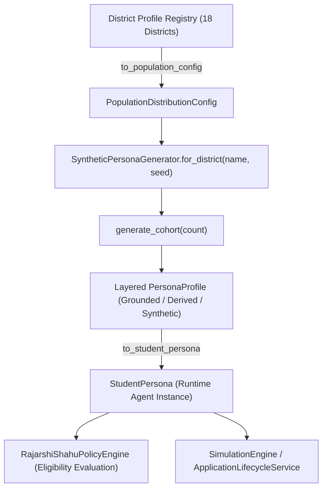

# Maharashtra District Educational Data Inventory & Demographic Provenance

**Author / Module Lead:** Vardayini (Population Generator + District Configuration)
**Project:** Maharashtra Policy Simulator
**Branch:** `feature/population-generator`
**Status:** Implemented and Verified

---

## 1. Executive Summary & Epistemic Hierarchy

The Maharashtra Policy Simulator generates synthetic student cohorts across the state to model citizen navigation and uptake of higher education scholarship schemes, specifically the **Rajarshi Chhatrapati Shahu Maharaj Shikshan Shulkh Shishyavrutti Yojna** (MahaDBT).

To maintain scientific integrity and prevent policy hallucination, all demographic and institutional distributions are structured under a strict **two-tier epistemic hierarchy**:

1. **Empirical Observed Tier (Pilot Districts - Dhule & Mumbai City):**
   - Anchored in directly verified empirical census and official administrative datasets (Educational Amenities Census / District Statistical Abstract 2010–11 and AISHE Maharashtra 2021–22 / DTE Annual Reports).
   - Institution distributions, gender enrolment ratios, and taluka subdivisions reflect observed administrative statistics.
2. **Provisional Baseline Tier (16 Districts):**
   - Anchored in Census 2011 district urbanization profiles, administrative division aggregates, and regional Directorate of Technical Education (DTE) intake patterns.
   - Micro-demographic dimensions absent from published district tables (e.g., exact intra-district private unaided collegiate income distributions) are explicitly cataloged as missing data and bridged via transparent, documented baseline fallbacks.
   - **Never fabricates synthetic numbers as official census facts.**

---

## 2. Methodology & Fallback Framework

### 2.1 The Challenge of District-Level Collegiate Data
In Maharashtra, higher education and technical education data are published at varying levels of administrative granularity:
- **School & Junior College Level:** Comprehensive district-level census data available via District Statistical Abstracts (DES Maharashtra) and UDISE+.
- **Higher Education Level (Colleges & Universities):** Aggregate state-level statistics published annually via the All India Survey on Higher Education (AISHE). However, district-level breakdowns in AISHE frequently conflate degree colleges with standalone teacher training or diploma polytechnics.
- **Micro-Demographics (Income & Caste inside Unaided Engineering):** Neither AISHE nor DTE publishes joint cross-tabulations of household income by caste category and taluka for enrolled students.

### 2.2 Standard Fallback Rules
Where empirical district-level records are unavailable:
1. **Gender Ratio Fallback:** Defaulted to regional division sex ratio or baseline `52:48` male-to-female ratio unless local collegiate census establishes higher parity (e.g., Mumbai City at `50.5:49.5`).
2. **Institution Type Fallback:** Standardized to typical Maharashtra district higher education landscape: `15% Government, 35% Government-Aided, 45% Private-Unaided, 5% Deemed/Private-University`, calibrated upward for unaided shares in industrial hubs (e.g., Kolhapur at `50% unaided`, Mumbai at `40% unaided`).
3. **Admission Mode Fallback:** Fixed at `80% CAP, 10% Institute-Level, 5% Management-Quota, 5% General-Merit` reflecting statutory centralized admissions under the Maharashtra Unaided Private Professional Educational Institutions Act, 2015.
4. **Income Distribution Fallback:** Modeled across five progressive economic tiers (`<=1.5L`, `1.5L-2.5L`, `2.5L-5.0L`, `5.0L-8.0L`, `>8.0L`) with 85% of synthetic candidates falling under the statutory ₹8,00,000 threshold to enable meaningful behavioral friction testing without biasing eligibility.

---

## 3. Inventory of 18 Assigned Districts

| # | District Name | Division | Region Type | Provenance Tier | Reference Year | Primary Empirical Source |
|---|---------------|----------|-------------|-----------------|----------------|--------------------------|
| 1 | **Dhule** | Nashik | Semi-Urban | Empirical Observed (Pilot) | 2010–11 | Educational Amenities Census / DES District Statistical Abstract |
| 2 | **Mumbai City** | Konkan | Urban | Empirical Observed (Pilot) | 2021–22 | AISHE Maharashtra Report 2021–22 & DTE Annual Statistics |
| 3 | **Ahilyanagar** | Nashik | Semi-Urban | Provisional Baseline | 2011 / 2022 | Census 2011 & DES Maharashtra District Abstract |
| 4 | **Akola** | Amravati | Semi-Urban | Provisional Baseline | 2011 / 2022 | Census 2011 & Sant Gadge Baba Amravati University Directory |
| 5 | **Amravati** | Amravati | Semi-Urban | Provisional Baseline | 2011 / 2022 | DES Amravati Abstract & DTE Regional Office Amravati |
| 6 | **Beed** | Sambhajinagar | Rural | Provisional Baseline | 2011 / 2022 | Census 2011 & Dr. BAMU Enrolment Statistics |
| 7 | **Bhandara** | Nagpur | Rural | Provisional Baseline | 2011 / 2022 | DES Bhandara Abstract & RTM Nagpur University Directory |
| 8 | **Buldhana** | Amravati | Rural | Provisional Baseline | 2011 / 2022 | Census 2011 & DES Buldhana Statistical Abstract |
| 9 | **Chandrapur** | Nagpur | Semi-Urban | Provisional Baseline | 2011 / 2022 | Gondwana University & DES Chandrapur Abstract |
| 10 | **Chhatrapati Sambhajinagar** | Sambhajinagar | Urban | Provisional Baseline | 2011 / 2022 | DTE Chhatrapati Sambhajinagar Region & Dr. BAMU Directory |
| 11 | **Dharashiv** | Sambhajinagar | Rural | Provisional Baseline | 2011 / 2022 | Census 2011 & DES Dharashiv Statistical Abstract |
| 12 | **Gadchiroli** | Nagpur | Rural (Tribal) | Provisional Baseline | 2011 / 2022 | DES Gadchiroli Abstract & Gondwana University Directory |
| 13 | **Gondia** | Nagpur | Rural (Tribal) | Provisional Baseline | 2011 / 2022 | Census 2011 & DES Gondia Abstract |
| 14 | **Hingoli** | Sambhajinagar | Rural | Provisional Baseline | 2011 / 2022 | Census 2011 & SRTMUN Nanded Institutional Directory |
| 15 | **Jalgaon** | Nashik | Semi-Urban | Provisional Baseline | 2011 / 2022 | KBC North Maharashtra University (NMU) & DES Jalgaon |
| 16 | **Jalna** | Sambhajinagar | Rural | Provisional Baseline | 2011 / 2022 | Census 2011 & Dr. BAMU Sub-Centre Directory |
| 17 | **Kolhapur** | Pune | Semi-Urban | Provisional Baseline | 2011 / 2022 | Shivaji University Enrolment & DTE Regional Office Pune |
| 18 | **Latur** | Sambhajinagar | Semi-Urban | Provisional Baseline | 2011 / 2022 | SRTMUN Sub-Centre & DTE Marathwada Higher Ed Records |

---

## 4. Deep-Dive: Pilot Districts (Empirical Observed)

### 4.1 Pilot 1: Dhule District
- **Division:** Nashik | **Region Type:** Semi-Urban
- **Source Reference:** Directorate of Economics and Statistics (DES), Maharashtra: District Statistical Abstract of Dhule District (Educational Amenities Tables)
- **Reference Year:** 2010–11
- **Source URL:** [https://mahasdb.maharashtra.gov.in](https://mahasdb.maharashtra.gov.in)
- **Available Statistics (Directly Observed):**
  - **Higher Education Institutions:** 0 Government Degree Colleges, 24 Government-Aided Colleges, 49 Private-Unaided Colleges. Total collegiate units: 73.
  - **Senior Secondary & Pre-University Enrolment:** 26,138 Boys, 19,882 Girls (Total: 46,020; Male ratio: 56.8%, Female ratio: 43.2%).
  - **Constituent Revenue Talukas:** Dhule, Shirpur, Sindkhede, Sakri.
- **Derived Simulation Priors & Estimates:**
  - **Taluka Weights (Derived Simulation Prior):** Dhule (60.6%), Shirpur (20.3%), Sindkhede (10.9%), Sakri (8.2%). Derived from higher education institution geographic clustering (major collegiate cluster in Dhule city and the R.C. Patel educational trust campus in Shirpur). Published DES tables do not provide taluka-wise student enrolment counts.
  - **Technical / Professional Stream Ratio:** 23.5% (0.235). Derived institutional estimate from college counts (17 technical/vocational institutions out of 73 total collegiate units: 4 engineering degree, 4 engineering diploma, 1 medical degree, 8 ITIs). Student-level enrolment by stream is unobserved at the district level.
- **Missing Data (District Tables):**
  - Taluka-wise student enrolment counts.
  - Household income breakdown within private engineering and polytechnic colleges.
  - Precise caste share in unaided professional degree streams.
- **Assumptions and Fallbacks:**
  - Caste distribution calibrated to North Maharashtra tribal/OBC belt: 32% General-EBC, 28% OBC, 18% ST, 12% SC, 5% VJNT, 5% General.
  - Income distribution anchored around median agriculture/trading household income with 80% under ₹8,00,000 threshold.
  - Citation limitation: Exact printed volume table numbers and page citations vary across publication editions and are unindexed on the DES web portal; figures reflect unindexed portal table extracts.

### 4.2 Pilot 2: Mumbai City District
- **Division:** Konkan | **Region Type:** Urban (100% Metropolitan)
- **Source Reference:** Ministry of Education, All India Survey on Higher Education (AISHE) Maharashtra 2021–22 & Directorate of Technical Education (DTE) Maharashtra
- **Reference Year:** 2021–22
- **Source URL:** [https://aishe.gov.in](https://aishe.gov.in) and [https://dtemaharashtra.gov.in](https://dtemaharashtra.gov.in)
- **Available Statistics (Directly Observed):**
  - **Urbanization Rate:** 100.0% (Zero rural census blocks; single contiguous metropolitan revenue district).
  - **Higher Education Gender Ratio Benchmark:** 50.5% Male, 49.5% Female (Near gender parity; AISHE state/metro benchmark).
  - **Approximate Collegiate Institution Count:** ~68 recognized degree and post-graduate colleges.
- **Provisional Simulation Priors & Estimates:**
  - **Geographical Modeling:** Mumbai City is an entirely urban district administered as a single revenue district without rural revenue talukas. Sub-district localities (such as Colaba, Fort, Byculla, Parel, Dadar, and Dharavi) are municipal wards rather than statutory revenue talukas. To preserve schema fidelity and avoid mislabelling municipal wards as talukas, the generator assigns taluka = 'Mumbai City' (defaulting to the revenue district level).
  - **Institutional Fabric (Provisional Simulation Prior):** 12% Government, 45% Government-Aided, 38% Private-Unaided, 5% Deemed/Private-University. Reflected as a provisional simulation prior modeling Mumbai's high density of historic state-aided/autonomous colleges (e.g., VJTI, ICT, Elphinstone, Wilson) alongside private unaided colleges; not directly observed from published district census tables.
  - **Technical / Professional Stream Share (Provisional Simulation Prior):** 38.0% (0.380) of collegiate enrolment, reflecting metropolitan engineering, pharmacy, and management concentration. Public AISHE report tables do not publish district-level student enrolment breakdowns by technical stream.
- **Missing Data (District Tables):**
  - Sub-district collegiate enrolment microdata (non-applicable for revenue talukas).
  - Direct caste breakdown within private unaided collegiate institutions.
  - Exact annual household income microdata.
  - District-level technical vs non-technical student enrolment splits.
- **Assumptions and Fallbacks:**
  - Income tiers reflect metropolitan living costs (median income higher than Vidarbha/Marathwada; 20% in >₹8.0L category).
  - High digital literacy baseline (mean 0.72 vs state mean 0.60) reflecting metropolitan cyber cafe, mobile penetration, and college administrative support.
  - Citation limitation: AISHE 2021–22 published reports provide state-wide aggregates; district-level tables are queried via unindexed web portal queries and are not asserted as verified print citations.

---

## 5. Catalog of Provisional Baseline Districts (16 Districts)

### 5.1 Ahilyanagar (Ahmednagar)
- **Division:** Nashik | **Region:** Semi-Urban (Cooperative sugar belt)
- **Talukas:** Nagar, Rahuri, Sangamner, Shrirampur, Kopargaon, Akole, Parner.
- **Observed Metrics:** Strong presence of rural aided educational trusts (Rayat Shikshan Sanstha, Pravara Rural Education Society). 30% professional stream ratio.
- **Missing Data:** Private engineering unaided fee distribution across rural talukas.
- **Fallbacks:** 12% Govt, 40% Govt-Aided, 43% Unaided, 5% Deemed.

### 5.2 Akola
- **Division:** Amravati (Vidarbha) | **Region:** Semi-Urban
- **Talukas:** Akola, Balapur, Patur, Barshitakli, Murtizapur, Telhara, Akot.
- **Observed Metrics:** Cotton processing commercial centre; Sant Gadge Baba Amravati University affiliated colleges.
- **Missing Data:** Annual household income of students in unaided pharmacy/polytechnic colleges.
- **Fallbacks:** 15% Govt, 35% Govt-Aided, 45% Unaided, 5% Deemed; 32% OBC, 22% SC, 26% General-EBC.

### 5.3 Amravati
- **Division:** Amravati | **Region:** Semi-Urban (Divisional HQ)
- **Talukas:** Amravati, Achalpur, Chandur Railway, Morshi, Warud, Teosa, Daryapur.
- **Observed Metrics:** Major educational hub for Western Vidarbha; Government College of Engineering, Amravati (GCOEA).
- **Missing Data:** Out-of-district student migration and income documentation.
- **Fallbacks:** 18% Govt, 37% Govt-Aided, 40% Unaided, 5% Deemed; 32% OBC, 20% SC, 12% ST.

### 5.4 Beed
- **Division:** Chhatrapati Sambhajinagar (Marathwada) | **Region:** Rural (Drought-prone)
- **Talukas:** Beed, Georai, Majalgaon, Ambajogai, Kaij, Ashti, Patoda.
- **Observed Metrics:** Low industrialization; seasonal migration patterns; Dr. BAMU affiliated colleges in Ambajogai and Beed.
- **Missing Data:** Informal agricultural household income verification rates.
- **Fallbacks:** 10% Govt, 35% Govt-Aided, 52% Unaided, 3% Deemed; 32% General-EBC, 28% OBC, 18% VJNT.

### 5.5 Bhandara
- **Division:** Nagpur | **Region:** Rural (Paddy & lake district)
- **Talukas:** Bhandara, Pauni, Mohadi, Tumsar, Sakoli, Lakhani, Lakhandur.
- **Observed Metrics:** Small collegiate network; dependent on RTM Nagpur University.
- **Missing Data:** Taluka-specific intake numbers for private IT/polytechnic institutes.
- **Fallbacks:** 12% Govt, 40% Govt-Aided, 45% Unaided, 3% Deemed; 38% OBC, 22% SC, 12% ST.

### 5.6 Buldhana
- **Division:** Amravati | **Region:** Rural
- **Talukas:** Buldhana, Chikhli, Mehkar, Khamgaon, Malkapur, Jalgaon Jamod, Shegaon.
- **Observed Metrics:** Khamgaon trade centre and Shegaon technical education cluster (SSGMCE).
- **Missing Data:** Income certification rejection rates at Tehsil level.
- **Fallbacks:** 12% Govt, 35% Govt-Aided, 48% Unaided, 5% Deemed; 30% OBC, 28% General-EBC.

### 5.7 Chandrapur
- **Division:** Nagpur | **Region:** Semi-Urban (Mining & industrial hub)
- **Talukas:** Chandrapur, Ballarpur, Bhadravati, Warora, Rajura, Mul, Bramhapuri.
- **Observed Metrics:** Government College of Engineering, Chandrapur; heavy coal/cement industrial employment.
- **Missing Data:** Informal vs formal industrial worker family income ratios.
- **Fallbacks:** 18% Govt, 32% Govt-Aided, 45% Unaided, 5% Deemed; 20% ST, 18% SC, 32% OBC.

### 5.8 Chhatrapati Sambhajinagar
- **Division:** Chhatrapati Sambhajinagar | **Region:** Urban (Industrial/educational hub)
- **Talukas:** Chhatrapati Sambhajinagar, Paithan, Gangapur, Vaijapur, Kannad, Sillod.
- **Observed Metrics:** Marathwada regional centre; Dr. BAMU university campus, Government College of Engineering (GECA), auto-cluster.
- **Missing Data:** Ward-level economic stratifications inside Aurangabad municipal area.
- **Fallbacks:** 15% Govt, 35% Govt-Aided, 45% Unaided, 5% Deemed; 32% General-EBC, 26% OBC, 20% SC.

### 5.9 Dharashiv (Osmanabad)
- **Division:** Chhatrapati Sambhajinagar | **Region:** Rural
- **Talukas:** Dharashiv, Tuljapur, Omerga, Paranda, Kalamb, Bhum, Washi.
- **Observed Metrics:** Agrarian economy; Dr. BAMU sub-centre; Dr. Babasaheb Ambedkar Marathwada University sub-campus.
- **Missing Data:** Exact private-unaided diploma completion statistics.
- **Fallbacks:** 10% Govt, 35% Govt-Aided, 52% Unaided, 3% Deemed; 32% General-EBC, 26% OBC, 18% SC.

### 5.10 Gadchiroli
- **Division:** Nagpur | **Region:** Rural (Tribal & Forested)
- **Talukas:** Gadchiroli, Aheri, Chamorshi, Armori, Dhanora, Kurkheda, Sironcha.
- **Observed Metrics:** Highest ST proportion in eastern Vidarbha; Gondwana University headquarters.
- **Missing Data:** Internet and MahaDBT connectivity uptime at village-level CSCs.
- **Fallbacks:** 25% Govt, 40% Govt-Aided, 33% Unaided, 2% Deemed; 42% ST, 16% SC, 22% OBC, 15% General-EBC.

### 5.11 Gondia
- **Division:** Nagpur | **Region:** Rural (Tribal border district)
- **Talukas:** Gondia, Tirora, Goregaon, Arjuni Morgaon, Deori, Salekasa, Sadak Arjuni.
- **Observed Metrics:** Rice mill cluster; high tribal forest area bordering Chhattisgarh and MP.
- **Missing Data:** Private professional college capacity in interior talukas.
- **Fallbacks:** 15% Govt, 40% Govt-Aided, 42% Unaided, 3% Deemed; 25% ST, 18% SC, 35% OBC.

### 5.12 Hingoli
- **Division:** Chhatrapati Sambhajinagar | **Region:** Rural
- **Talukas:** Hingoli, Basmath, Kalamnuri, Sengaon, Aundha Nagnath.
- **Observed Metrics:** Agrarian Marathwada district; reliant on SRTMUN Nanded for higher ed.
- **Missing Data:** Out-migration to Nanded and Chhatrapati Sambhajinagar for engineering degrees.
- **Fallbacks:** 10% Govt, 38% Govt-Aided, 50% Unaided, 2% Deemed; 30% General-EBC, 28% OBC, 20% SC.

### 5.13 Jalgaon
- **Division:** Nashik | **Region:** Semi-Urban (Banana & gold trade)
- **Talukas:** Jalgaon, Bhusawal, Chalisgaon, Pachora, Amalner, Chopda, Raver, Yaval.
- **Observed Metrics:** Kavayitri Bahinabai Chaudhari North Maharashtra University (KBCNMU); large private engineering colleges (SSBT COET, Raisoni).
- **Missing Data:** Actual management quota seat proportion in local private colleges.
- **Fallbacks:** 12% Govt, 38% Govt-Aided, 46% Unaided, 4% Deemed; 34% OBC, 28% General-EBC.

### 5.14 Jalna
- **Division:** Chhatrapati Sambhajinagar | **Region:** Rural (Seed capital & steel rolling)
- **Talukas:** Jalna, Ambad, Partur, Bhokardan, Jafrabad, Badnapur, Ghansawangi.
- **Observed Metrics:** Dr. BAMU sub-centre, ICT Mumbai Marathwada off-campus centre.
- **Missing Data:** Student attendance and dropout percentages in unaided institutes.
- **Fallbacks:** 12% Govt, 36% Govt-Aided, 49% Unaided, 3% Deemed; 32% General-EBC, 26% OBC, 18% SC.

### 5.15 Kolhapur
- **Division:** Pune (Western Maharashtra) | **Region:** Semi-Urban (Industrial & sugar belt)
- **Talukas:** Karvir, Hatkanangle, Shirol, Radhanagari, Panhala, Kagal, Gadhinglaj.
- **Observed Metrics:** Shivaji University HQ; strong network of autonomous and unaided engineering colleges (KIT, DKTE, Sanjay Ghodawat).
- **Missing Data:** Family income verification audits across cooperative society employees.
- **Fallbacks:** 12% Govt, 38% Govt-Aided, 45% Unaided, 5% Deemed; 35% General-EBC, 28% OBC, 15% SC.

### 5.16 Latur
- **Division:** Chhatrapati Sambhajinagar | **Region:** Semi-Urban (Renowned educational pattern)
- **Talukas:** Latur, Udgir, Ahmedpur, Nilanga, Ausa, Chakur, Renapur.
- **Observed Metrics:** "Latur Pattern" competitive exam coaching centre; major collegiate destination for Marathwada students.
- **Missing Data:** Proportion of temporary migrant students from other districts in Latur colleges.
- **Fallbacks:** 12% Govt, 38% Govt-Aided, 46% Unaided, 4% Deemed; 32% General-EBC, 28% OBC, 18% SC.

---

## 6. How the Generator Consumes District Profiles

The `SyntheticPersonaGenerator` consumes `DistrictProfile` objects via `DistrictProfile.to_population_config()`:

### Determinism and Reproducibility
- Every generator method supports an explicit `seed: int` parameter.
- Calling `SyntheticPersonaGenerator.for_district("Dhule", seed=42).generate_cohort(20)` yields identical, reproducible student attributes every run.
- Passing differing seeds guarantees demographic variance matching the district distribution priors.
