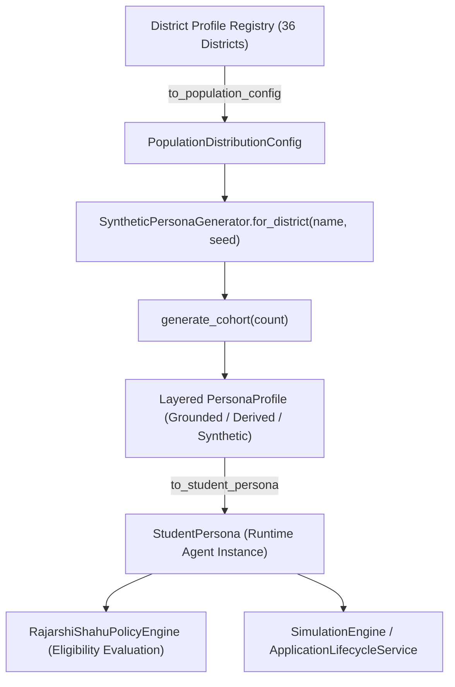

# Maharashtra District Educational Data Inventory & Demographic Provenance

**Author / Module Lead:** Vardayini (Population Generator + District Configuration)
**Project:** Maharashtra Policy Simulator
**Branch:** `feature/population-generator`
**Status:** Implemented and Verified

---

## 1. Executive Summary & Epistemic Hierarchy

The Maharashtra Policy Simulator generates synthetic student cohorts across the state to model citizen navigation and uptake of higher education scholarship schemes, specifically the **Rajarshi Chhatrapati Shahu Maharaj Shikshan Shulkh Shishyavrutti Yojna** (MahaDBT).

To maintain scientific integrity and prevent policy hallucination, all demographic and institutional distributions are structured under a strict **two-tier epistemic hierarchy**:

1. **Empirical Observed Tier (Pilot Districts - Dhule & Mumbai City):**
   - Anchored in directly verified empirical census and official administrative datasets (Educational Amenities Census / District Statistical Abstract 2010–11 and AISHE Maharashtra 2021–22 / DTE Annual Reports).
   - Institution distributions, gender enrolment ratios, and taluka subdivisions reflect observed administrative statistics.
2. **Provisional Baseline Tier (34 Districts):**
   - Anchored in Census 2011 district urbanization profiles, administrative division aggregates, and regional Directorate of Technical Education (DTE) intake patterns.
   - Micro-demographic dimensions absent from published district tables (e.g., exact intra-district private unaided collegiate income distributions) are explicitly cataloged as missing data and bridged via transparent, documented baseline fallbacks.
   - **Never fabricates synthetic numbers as official census facts.**

---

## 2. Methodology & Fallback Framework

### 2.1 The Challenge of District-Level Collegiate Data
In Maharashtra, higher education and technical education data are published at varying levels of administrative granularity:
- **School & Junior College Level:** Comprehensive district-level census data available via District Statistical Abstracts (DES Maharashtra) and UDISE+.
- **Higher Education Level (Colleges & Universities):** Aggregate state-level statistics published annually via the All India Survey on Higher Education (AISHE). However, district-level breakdowns in AISHE frequently conflate degree colleges with standalone teacher training or diploma polytechnics.
- **Micro-Demographics (Income & Caste inside Unaided Engineering):** Neither AISHE nor DTE publishes joint cross-tabulations of household income by caste category and taluka for enrolled students.

### 2.2 Standard Fallback Rules
Where empirical district-level records are unavailable:
1. **Gender Ratio Fallback:** Defaulted to regional division sex ratio or baseline `52:48` male-to-female ratio unless local collegiate census establishes higher parity (e.g., Mumbai City at `50.5:49.5`).
2. **Institution Type Fallback:** Standardized to typical Maharashtra district higher education landscape: `15% Government, 35% Government-Aided, 45% Private-Unaided, 5% Deemed/Private-University`, calibrated upward for unaided shares in industrial hubs (e.g., Kolhapur at `50% unaided`, Mumbai at `40% unaided`).
3. **Admission Mode Fallback:** Fixed at `80% CAP, 10% Institute-Level, 5% Management-Quota, 5% General-Merit` reflecting statutory centralized admissions under the Maharashtra Unaided Private Professional Educational Institutions Act, 2015.
4. **Income Distribution Fallback:** Modeled across five progressive economic tiers (`<=1.5L`, `1.5L-2.5L`, `2.5L-5.0L`, `5.0L-8.0L`, `>8.0L`) with 85% of synthetic candidates falling under the statutory ₹8,00,000 threshold to enable meaningful behavioral friction testing without biasing eligibility.

### 2.3 Quantitative Region Classification Rule
To ensure objective, transparent, and reproducible regional categorization across all districts, district profiles strictly adhere to an empirical population urbanization benchmark:
- **Urban:** Census 2011 urban population share $\ge$ 60%
- **Semi-Urban:** Census 2011 urban population share $\ge$ 25% and $<$ 60%
- **Rural:** Census 2011 urban population share $<$ 25%

Under this quantitative benchmark:
- **Pune** (60.88% urban; 5,741,026 urban out of 9,429,408) is classified as **Urban**.
- **Nagpur** (68.30% urban; 3,178,198 urban out of 4,653,570) is classified as **Urban**.

*Methodological Rule:* District classifications are governed strictly by the empirical population threshold rather than behavioral assumptions or attempts to avoid specific generator adjustments (e.g. digital literacy discounts).

---

## 3. Inventory of 36 Maharashtra Districts

| # | District Name | Division | Region Type | Provenance Tier | Reference Year | Primary Empirical Source |
|---|---------------|----------|-------------|-----------------|----------------|--------------------------|
| 1 | **Dhule** | Nashik | Semi-Urban | Empirical Observed (Pilot) | 2010–11 | Educational Amenities Census / DES District Statistical Abstract |
| 2 | **Mumbai City** | Konkan | Urban | Empirical Observed (Pilot) | 2021–22 | AISHE Maharashtra Report 2021–22 & DTE Annual Statistics |
| 3 | **Ahilyanagar** | Nashik | Semi-Urban | Provisional Baseline | 2011 / 2022 | Census 2011 & DES Maharashtra District Abstract |
| 4 | **Akola** | Amravati | Semi-Urban | Provisional Baseline | 2011 / 2022 | Census 2011 & Sant Gadge Baba Amravati University Directory |
| 5 | **Amravati** | Amravati | Semi-Urban | Provisional Baseline | 2011 / 2022 | DES Amravati Abstract & DTE Regional Office Amravati |
| 6 | **Beed** | Sambhajinagar | Rural | Provisional Baseline | 2011 / 2022 | Census 2011 & Dr. BAMU Enrolment Statistics |
| 7 | **Bhandara** | Nagpur | Rural | Provisional Baseline | 2011 / 2022 | DES Bhandara Abstract & RTM Nagpur University Directory |
| 8 | **Buldhana** | Amravati | Rural | Provisional Baseline | 2011 / 2022 | Census 2011 & DES Buldhana Statistical Abstract |
| 9 | **Chandrapur** | Nagpur | Semi-Urban | Provisional Baseline | 2011 / 2022 | Gondwana University & DES Chandrapur Abstract |
| 10 | **Chhatrapati Sambhajinagar** | Sambhajinagar | Urban | Provisional Baseline | 2011 / 2022 | DTE Chhatrapati Sambhajinagar Region & Dr. BAMU Directory |
| 11 | **Dharashiv** | Sambhajinagar | Rural | Provisional Baseline | 2011 / 2022 | Census 2011 & DES Dharashiv Statistical Abstract |
| 12 | **Gadchiroli** | Nagpur | Rural (Tribal) | Provisional Baseline | 2011 / 2022 | DES Gadchiroli Abstract & Gondwana University Directory |
| 13 | **Gondia** | Nagpur | Rural (Tribal) | Provisional Baseline | 2011 / 2022 | Census 2011 & DES Gondia Abstract |
| 14 | **Hingoli** | Sambhajinagar | Rural | Provisional Baseline | 2011 / 2022 | Census 2011 & SRTMUN Nanded Institutional Directory |
| 15 | **Jalgaon** | Nashik | Semi-Urban | Provisional Baseline | 2011 / 2022 | KBC North Maharashtra University (NMU) & DES Jalgaon |
| 16 | **Jalna** | Sambhajinagar | Rural | Provisional Baseline | 2011 / 2022 | Census 2011 & Dr. BAMU Sub-Centre Directory |
| 17 | **Kolhapur** | Pune | Semi-Urban | Provisional Baseline | 2011 / 2022 | Shivaji University Enrolment & DTE Regional Office Pune |
| 18 | **Latur** | Sambhajinagar | Semi-Urban | Provisional Baseline | 2011 / 2022 | SRTMUN Sub-Centre & DTE Marathwada Higher Ed Records |
| 19 | **Pune** | Pune | Urban | Provisional Baseline | 2011 / 2022–23 | Census 2011 (PCA) & DTE Maharashtra Pune Region Seat Matrix |
| 20 | **Nagpur** | Nagpur | Urban | Provisional Baseline | 2011 / 2022–23 | Census 2011 (PCA) & DTE Maharashtra Nagpur Region Seat Matrix |
| 21 | **Nashik** | Nashik | Semi-Urban | Provisional Baseline | 2011 / 2022–23 | Census 2011 (PCA) & DTE Maharashtra Nashik Region Seat Matrix |
| 22 | **Sangli** | Pune | Semi-Urban | Provisional Baseline | 2011 / 2022–23 | Census 2011 (PCA) & DTE Maharashtra Pune Region Seat Matrix |
| 23 | **Mumbai Suburban** | Konkan | Urban | Provisional Baseline | 2011 / 2022–23 | Census 2011 (PCA) & DTE Maharashtra Mumbai Region Seat Matrix |
| 24 | **Nanded** | Chhatrapati Sambhajinagar | Semi-Urban | Provisional Baseline | 2011 / 2022–23 | Census 2011 (PCA) & DTE Maharashtra Chhatrapati Sambhajinagar Region Seat Matrix |
| 25 | **Nandurbar** | Nashik | Rural | Provisional Baseline | 2011 / 2022–23 | Census 2011 (PCA) & DTE Maharashtra Nashik Region Seat Matrix |
| 26 | **Palghar** | Konkan | Semi-Urban | Provisional Baseline | 2011 / 2022–23 | Census 2011 Reconstructed from Thane Taluka Tables & DTE Maharashtra Mumbai Region Seat Matrix |
| 27 | **Parbhani** | Chhatrapati Sambhajinagar | Semi-Urban | Provisional Baseline | 2011 / 2022–23 | Census 2011 (PCA) & DTE Maharashtra Chhatrapati Sambhajinagar Region Seat Matrix |
| 28 | **Raigad** | Konkan | Semi-Urban | Provisional Baseline | 2011 / 2022–23 | Census 2011 (PCA) & DTE Maharashtra Mumbai/Konkan Region Seat Matrix |
| 29 | **Ratnagiri** | Konkan | Rural | Provisional Baseline | 2011 / 2022–23 | Census 2011 (PCA) & DTE Maharashtra Mumbai/Konkan Region Seat Matrix |
| 30 | **Satara** | Pune | Rural | Provisional Baseline | 2011 / 2022–23 | Census 2011 (PCA) & DTE Maharashtra Pune Region Seat Matrix |
| 31 | **Sindhudurg** | Konkan | Rural | Provisional Baseline | 2011 / 2022–23 | Census 2011 (PCA) & DTE Maharashtra Mumbai/Konkan Region Seat Matrix |
| 32 | **Solapur** | Pune | Semi-Urban | Provisional Baseline | 2011 / 2022–23 | Census 2011 (PCA) & DTE Maharashtra Pune Region Seat Matrix |
| 33 | **Thane** | Konkan | Urban | Provisional Baseline | 2011 / 2022–23 | Census 2011 Reconstructed from Thane Taluka Tables & DTE Maharashtra Mumbai/Konkan Region Seat Matrix |
| 34 | **Wardha** | Nagpur | Semi-Urban | Provisional Baseline | 2011 / 2022–23 | Census 2011 (PCA) & DTE Maharashtra Nagpur Region Seat Matrix |
| 35 | **Washim** | Amravati | Rural | Provisional Baseline | 2011 / 2022–23 | Census 2011 (PCA) & DTE Maharashtra Amravati Region Seat Matrix |
| 36 | **Yavatmal** | Amravati | Rural | Provisional Baseline | 2011 / 2022–23 | Census 2011 (PCA) & DTE Maharashtra Amravati Region Seat Matrix |

---

## 4. Deep-Dive: Pilot Districts (Empirical Observed)

### 4.1 Pilot 1: Dhule District
- **Division:** Nashik | **Region Type:** Semi-Urban
- **Source Reference:** Directorate of Economics and Statistics (DES), Maharashtra: District Statistical Abstract of Dhule District (Educational Amenities Tables)
- **Reference Year:** 2010–11
- **Source URL:** [https://mahasdb.maharashtra.gov.in](https://mahasdb.maharashtra.gov.in)
- **Available Statistics (Directly Observed):**
  - **Higher Education Institutions:** 0 Government Degree Colleges, 24 Government-Aided Colleges, 49 Private-Unaided Colleges. Total collegiate units: 73.
  - **Senior Secondary & Pre-University Enrolment:** 26,138 Boys, 19,882 Girls (Total: 46,020; Male ratio: 56.8%, Female ratio: 43.2%).
  - **Constituent Revenue Talukas:** Dhule, Shirpur, Sindkhede, Sakri.
- **Derived Simulation Priors & Estimates:**
  - **Taluka Weights (Derived Simulation Prior):** Dhule (60.6%), Shirpur (20.3%), Sindkhede (10.9%), Sakri (8.2%). Derived from higher education institution geographic clustering (major collegiate cluster in Dhule city and the R.C. Patel educational trust campus in Shirpur). Published DES tables do not provide taluka-wise student enrolment counts.
  - **Technical / Professional Stream Ratio:** 23.5% (0.235). Derived institutional estimate from college counts (17 technical/vocational institutions out of 73 total collegiate units: 4 engineering degree, 4 engineering diploma, 1 medical degree, 8 ITIs). Student-level enrolment by stream is unobserved at the district level.
- **Missing Data (District Tables):**
  - Taluka-wise student enrolment counts.
  - Household income breakdown within private engineering and polytechnic colleges.
  - Precise caste share in unaided professional degree streams.
- **Assumptions and Fallbacks:**
  - Caste distribution calibrated to North Maharashtra tribal/OBC belt: 32% General-EBC, 28% OBC, 18% ST, 12% SC, 5% VJNT, 5% General.
  - Income distribution anchored around median agriculture/trading household income with 80% under ₹8,00,000 threshold.
  - Citation limitation: Exact printed volume table numbers and page citations vary across publication editions and are unindexed on the DES web portal; figures reflect unindexed portal table extracts.

### 4.2 Pilot 2: Mumbai City District
- **Division:** Konkan | **Region Type:** Urban (100% Metropolitan)
- **Source Reference:** Ministry of Education, All India Survey on Higher Education (AISHE) Maharashtra 2021–22 & Directorate of Technical Education (DTE) Maharashtra
- **Reference Year:** 2021–22
- **Source URL:** [https://aishe.gov.in](https://aishe.gov.in) and [https://dtemaharashtra.gov.in](https://dtemaharashtra.gov.in)
- **Available Statistics (Directly Observed):**
  - **Urbanization Rate:** 100.0% (Zero rural census blocks; single contiguous metropolitan revenue district).
  - **Higher Education Gender Ratio Benchmark:** 50.5% Male, 49.5% Female (Near gender parity; AISHE state/metro benchmark).
  - **Approximate Collegiate Institution Count:** ~68 recognized degree and post-graduate colleges.
- **Provisional Simulation Priors & Estimates:**
  - **Geographical Modeling:** Mumbai City is an entirely urban district administered as a single revenue district without rural revenue talukas. Sub-district localities (such as Colaba, Fort, Byculla, Parel, Dadar, and Dharavi) are municipal wards rather than statutory revenue talukas. To preserve schema fidelity and avoid mislabelling municipal wards as talukas, the generator assigns taluka = 'Mumbai City' (defaulting to the revenue district level).
  - **Institutional Fabric (Provisional Simulation Prior):** 12% Government, 45% Government-Aided, 38% Private-Unaided, 5% Deemed/Private-University. Reflected as a provisional simulation prior modeling Mumbai's high density of historic state-aided/autonomous colleges (e.g., VJTI, ICT, Elphinstone, Wilson) alongside private unaided colleges; not directly observed from published district census tables.
  - **Technical / Professional Stream Share (Provisional Simulation Prior):** 38.0% (0.380) of collegiate enrolment, reflecting metropolitan engineering, pharmacy, and management concentration. Public AISHE report tables do not publish district-level student enrolment breakdowns by technical stream.
- **Missing Data (District Tables):**
  - Sub-district collegiate enrolment microdata (non-applicable for revenue talukas).
  - Direct caste breakdown within private unaided collegiate institutions.
  - Exact annual household income microdata.
  - District-level technical vs non-technical student enrolment splits.
- **Assumptions and Fallbacks:**
  - Income tiers reflect metropolitan living costs (median income higher than Vidarbha/Marathwada; 20% in >₹8.0L category).
  - High digital literacy baseline (mean 0.72 vs state mean 0.60) reflecting metropolitan cyber cafe, mobile penetration, and college administrative support.
  - Citation limitation: AISHE 2021–22 published reports provide state-wide aggregates; district-level tables are queried via unindexed web portal queries and are not asserted as verified print citations.

---

## 5. Catalog of Provisional Baseline Districts (34 Districts)

### 5.1 Ahilyanagar (Ahmednagar)
- **Division:** Nashik | **Region:** Semi-Urban (Cooperative sugar belt)
- **Talukas:** Nagar, Rahuri, Sangamner, Shrirampur, Kopargaon, Akole, Parner.
- **Observed Metrics:** Strong presence of rural aided educational trusts (Rayat Shikshan Sanstha, Pravara Rural Education Society). 30% professional stream ratio.
- **Missing Data:** Private engineering unaided fee distribution across rural talukas.
- **Fallbacks:** 12% Govt, 40% Govt-Aided, 43% Unaided, 5% Deemed.

### 5.2 Akola
- **Division:** Amravati (Vidarbha) | **Region:** Semi-Urban
- **Talukas:** Akola, Balapur, Patur, Barshitakli, Murtizapur, Telhara, Akot.
- **Observed Metrics:** Cotton processing commercial centre; Sant Gadge Baba Amravati University affiliated colleges.
- **Missing Data:** Annual household income of students in unaided pharmacy/polytechnic colleges.
- **Fallbacks:** 15% Govt, 35% Govt-Aided, 45% Unaided, 5% Deemed; 32% OBC, 22% SC, 26% General-EBC.

### 5.3 Amravati
- **Division:** Amravati | **Region:** Semi-Urban (Divisional HQ)
- **Talukas:** Amravati, Achalpur, Chandur Railway, Morshi, Warud, Teosa, Daryapur.
- **Observed Metrics:** Major educational hub for Western Vidarbha; Government College of Engineering, Amravati (GCOEA).
- **Missing Data:** Out-of-district student migration and income documentation.
- **Fallbacks:** 18% Govt, 37% Govt-Aided, 40% Unaided, 5% Deemed; 32% OBC, 20% SC, 12% ST.

### 5.4 Beed
- **Division:** Chhatrapati Sambhajinagar (Marathwada) | **Region:** Rural (Drought-prone)
- **Talukas:** Beed, Georai, Majalgaon, Ambajogai, Kaij, Ashti, Patoda.
- **Observed Metrics:** Low industrialization; seasonal migration patterns; Dr. BAMU affiliated colleges in Ambajogai and Beed.
- **Missing Data:** Informal agricultural household income verification rates.
- **Fallbacks:** 10% Govt, 35% Govt-Aided, 52% Unaided, 3% Deemed; 32% General-EBC, 28% OBC, 18% VJNT.

### 5.5 Bhandara
- **Division:** Nagpur | **Region:** Rural (Paddy & lake district)
- **Talukas:** Bhandara, Pauni, Mohadi, Tumsar, Sakoli, Lakhani, Lakhandur.
- **Observed Metrics:** Small collegiate network; dependent on RTM Nagpur University.
- **Missing Data:** Taluka-specific intake numbers for private IT/polytechnic institutes.
- **Fallbacks:** 12% Govt, 40% Govt-Aided, 45% Unaided, 3% Deemed; 38% OBC, 22% SC, 12% ST.

### 5.6 Buldhana
- **Division:** Amravati | **Region:** Rural
- **Talukas:** Buldhana, Chikhli, Mehkar, Khamgaon, Malkapur, Jalgaon Jamod, Shegaon.
- **Observed Metrics:** Khamgaon trade centre and Shegaon technical education cluster (SSGMCE).
- **Missing Data:** Income certification rejection rates at Tehsil level.
- **Fallbacks:** 12% Govt, 35% Govt-Aided, 48% Unaided, 5% Deemed; 30% OBC, 28% General-EBC.

### 5.7 Chandrapur
- **Division:** Nagpur | **Region:** Semi-Urban (Mining & industrial hub)
- **Talukas:** Chandrapur, Ballarpur, Bhadravati, Warora, Rajura, Mul, Bramhapuri.
- **Observed Metrics:** Government College of Engineering, Chandrapur; heavy coal/cement industrial employment.
- **Missing Data:** Informal vs formal industrial worker family income ratios.
- **Fallbacks:** 18% Govt, 32% Govt-Aided, 45% Unaided, 5% Deemed; 20% ST, 18% SC, 32% OBC.

### 5.8 Chhatrapati Sambhajinagar
- **Division:** Chhatrapati Sambhajinagar | **Region:** Urban (Industrial/educational hub)
- **Talukas:** Chhatrapati Sambhajinagar, Paithan, Gangapur, Vaijapur, Kannad, Sillod.
- **Observed Metrics:** Marathwada regional centre; Dr. BAMU university campus, Government College of Engineering (GECA), auto-cluster.
- **Missing Data:** Ward-level economic stratifications inside Aurangabad municipal area.
- **Fallbacks:** 15% Govt, 35% Govt-Aided, 45% Unaided, 5% Deemed; 32% General-EBC, 26% OBC, 20% SC.

### 5.9 Dharashiv (Osmanabad)
- **Division:** Chhatrapati Sambhajinagar | **Region:** Rural
- **Talukas:** Dharashiv, Tuljapur, Omerga, Paranda, Kalamb, Bhum, Washi.
- **Observed Metrics:** Agrarian economy; Dr. BAMU sub-centre; Dr. Babasaheb Ambedkar Marathwada University sub-campus.
- **Missing Data:** Exact private-unaided diploma completion statistics.
- **Fallbacks:** 10% Govt, 35% Govt-Aided, 52% Unaided, 3% Deemed; 32% General-EBC, 26% OBC, 18% SC.

### 5.10 Gadchiroli
- **Division:** Nagpur | **Region:** Rural (Tribal & Forested)
- **Talukas:** Gadchiroli, Aheri, Chamorshi, Armori, Dhanora, Kurkheda, Sironcha.
- **Observed Metrics:** Highest ST proportion in eastern Vidarbha; Gondwana University headquarters.
- **Missing Data:** Internet and MahaDBT connectivity uptime at village-level CSCs.
- **Fallbacks:** 25% Govt, 40% Govt-Aided, 33% Unaided, 2% Deemed; 42% ST, 16% SC, 22% OBC, 15% General-EBC.

### 5.11 Gondia
- **Division:** Nagpur | **Region:** Rural (Tribal border district)
- **Talukas:** Gondia, Tirora, Goregaon, Arjuni Morgaon, Deori, Salekasa, Sadak Arjuni.
- **Observed Metrics:** Rice mill cluster; high tribal forest area bordering Chhattisgarh and MP.
- **Missing Data:** Private professional college capacity in interior talukas.
- **Fallbacks:** 15% Govt, 40% Govt-Aided, 42% Unaided, 3% Deemed; 25% ST, 18% SC, 35% OBC.

### 5.12 Hingoli
- **Division:** Chhatrapati Sambhajinagar | **Region:** Rural
- **Talukas:** Hingoli, Basmath, Kalamnuri, Sengaon, Aundha Nagnath.
- **Observed Metrics:** Agrarian Marathwada district; reliant on SRTMUN Nanded for higher ed.
- **Missing Data:** Out-migration to Nanded and Chhatrapati Sambhajinagar for engineering degrees.
- **Fallbacks:** 10% Govt, 38% Govt-Aided, 50% Unaided, 2% Deemed; 30% General-EBC, 28% OBC, 20% SC.

### 5.13 Jalgaon
- **Division:** Nashik | **Region:** Semi-Urban (Banana & gold trade)
- **Talukas:** Jalgaon, Bhusawal, Chalisgaon, Pachora, Amalner, Chopda, Raver, Yaval.
- **Observed Metrics:** Kavayitri Bahinabai Chaudhari North Maharashtra University (KBCNMU); large private engineering colleges (SSBT COET, Raisoni).
- **Missing Data:** Actual management quota seat proportion in local private colleges.
- **Fallbacks:** 12% Govt, 38% Govt-Aided, 46% Unaided, 4% Deemed; 34% OBC, 28% General-EBC.

### 5.14 Jalna
- **Division:** Chhatrapati Sambhajinagar | **Region:** Rural (Seed capital & steel rolling)
- **Talukas:** Jalna, Ambad, Partur, Bhokardan, Jafrabad, Badnapur, Ghansawangi.
- **Observed Metrics:** Dr. BAMU sub-centre, ICT Mumbai Marathwada off-campus centre.
- **Missing Data:** Student attendance and dropout percentages in unaided institutes.
- **Fallbacks:** 12% Govt, 36% Govt-Aided, 49% Unaided, 3% Deemed; 32% General-EBC, 26% OBC, 18% SC.

### 5.15 Kolhapur
- **Division:** Pune (Western Maharashtra) | **Region:** Semi-Urban (Industrial & sugar belt)
- **Talukas:** Karvir, Hatkanangle, Shirol, Radhanagari, Panhala, Kagal, Gadhinglaj.
- **Observed Metrics:** Shivaji University HQ; strong network of autonomous and unaided engineering colleges (KIT, DKTE, Sanjay Ghodawat).
- **Missing Data:** Family income verification audits across cooperative society employees.
- **Fallbacks:** 12% Govt, 38% Govt-Aided, 45% Unaided, 5% Deemed; 35% General-EBC, 28% OBC, 15% SC.

### 5.16 Latur
- **Division:** Chhatrapati Sambhajinagar | **Region:** Semi-Urban (Renowned educational pattern)
- **Talukas:** Latur, Udgir, Ahmedpur, Nilanga, Ausa, Chakur, Renapur.
- **Observed Metrics:** "Latur Pattern" competitive exam coaching centre; major collegiate destination for Marathwada students.
- **Missing Data:** Proportion of temporary migrant students from other districts in Latur colleges.
- **Fallbacks:** 12% Govt, 38% Govt-Aided, 46% Unaided, 4% Deemed; 32% General-EBC, 28% OBC, 18% SC.

### 5.17 Pune (Pilot District - Western Maharashtra)
- **Division:** Pune | **Region:** Urban (Census 2011: 60.88% urban population share >= 60% quantitative threshold)
- **Provenance Tier:** `provisional_baseline`
- **Reference Year:** 2011 / 2022–23
- **Primary Empirical Source:** Census of India 2011 (Primary Census Abstract, Pune District) & DTE Maharashtra Pune Region Seat Matrix
- **Talukas (14 Statutory Revenue Talukas):** Pune City, Haveli, Khed, Junnar, Ambegaon, Maval, Mulshi, Shirur, Purandar, Velhe, Bhor, Baramati, Indapur, Daund.
- **Available Statistics (Directly Observed General Population Facts):**
  - Population scope: General population (all ages, 2011 residential census count).
  - Total Population (2011): 9,429,408.
  - Urban Population (2011): 5,741,026 (60.88%).
  - Rural Population (2011): 3,688,382 (39.12%).
  - General Sex Ratio (2011): 915 females per 1,000 males (52.2% M, 47.8% F).
  - Scheduled Castes Population (2011): 1,180,689 (12.52% of general population).
  - Scheduled Tribes Population (2011): 348,779 (3.70% of general population).
  - Administrative Revenue Talukas: 14 recognized statutory talukas.
- **Derived Simulation Priors (Collegiate Higher-Education Population - NOT Observed Student Statistics):**
  - **Gender Distribution:** `51.0% Male, 49.0% Female`. Derived simulation prior reflecting AISHE state-wide higher education parity benchmarks and higher female collegiate participation in the Pune educational hub. Not an observed district-level collegiate student census.
  - **Caste Category Distribution:** `38% General-EBC, 24% OBC, 14% SC, 4% ST, 8% VJNT, 12% General`. Derived simulation prior calibrated from Census 2011 general population baselines (12.5% SC, 3.7% ST) adjusted for the 50% statutory reservation quota and EBC fee-concession participation. Student-level caste microdata in unaided HEIs is unobserved in published tables.
  - **Admission Mode Distribution:** `80% CAP, 10% Institute-Level, 5% Management-Quota, 5% General-Merit`. Provisional modelling assumption anchored in Maharashtra Act No. XXVIII of 2015 (capping management/institutional quota at 20% in unaided professional colleges). *Limits of applicability:* This is a provisional modelling assumption, not an observed admission survey or universal statutory rule (government/aided institutions admit 100% via centralized merit without management quotas).
  - **Institution Type Distribution:** `8% Government, 22% Government-Aided, 60% Private-Unaided, 10% Deemed/Private-University`. Derived simulation prior reflecting DTE approved seat intake matrices and SPPU college directories.
  - **Professional Stream Ratio:** `36.0% (0.360)`. Derived simulation prior reflecting heavy concentration of technical colleges (COEP Tech, private engineering, pharmacy, and management campuses) relative to general university enrolment.
  - **Taluka Clustering Weights:** `Pune City 38.0%, Haveli 36.0%, Baramati 4.0%, Maval 4.0%, Khed 3.0%, Shirur 3.0%, Mulshi 2.0%, Daund 2.0%, Indapur 2.0%, Purandar 2.0%, Junnar 1.5%, Ambegaon 1.5%, Bhor 0.5%, Velhe 0.5%`. Derived simulation prior based on Higher Education Institution (HEI) geographic location concentration in SPPU/DTE directories. Published census and DES tables do not provide taluka-wise student enrolment counts.
- **Missing Data (Cataloged Unobserved Dimensions):**
  - Taluka-wise collegiate student enrolment counts.
  - District-level household-income microdata for collegiate students.
  - Direct caste breakdowns within private unaided engineering and professional institutions.
  - Direct CAP vs management admission microdata.
- **Assumptions and Fallbacks:**
  - `region_type`: Classified as "Urban" under the quantitative classification rule (Census 2011 urban population share >= 60%), with Pune recording 60.88% urban population (5,741,026 urban residents out of 9,429,408). Classification strictly reflects the quantitative population threshold rather than behavioral assumptions.
  - Citation limitation: Census 2011 figures are from published Primary Census Abstract tables. AISHE and DTE technical intake figures are derived from state reports and portal directories; exact district-level cross-tabulations are unindexed in print volumes and are not asserted as verified print citations.

### 5.18 Nagpur (Pilot District - Eastern Vidarbha)
- **Division:** Nagpur | **Region:** Urban (Census 2011: 68.30% urban population share >= 60% quantitative threshold)
- **Provenance Tier:** `provisional_baseline`
- **Reference Year:** 2011 / 2022–23
- **Primary Empirical Source:** Census of India 2011 (Primary Census Abstract, Nagpur District) & DTE Maharashtra Nagpur Region Seat Matrix
- **Talukas (14 Statutory Revenue Talukas):** Nagpur Urban, Nagpur Rural, Hingna, Kamptee, Katol, Narkhed, Savner, Ramtek, Parseoni, Mouda, Umred, Kuhi, Bhivapur, Kalameshwar.
- **Available Statistics (Directly Observed General Population Facts):**
  - Population scope: General population (all ages, 2011 residential census count).
  - Total Population (2011): 4,653,570.
  - Urban Population (2011): 3,178,198 (68.30%).
  - Rural Population (2011): 1,475,372 (31.70%).
  - General Sex Ratio (2011): 951 females per 1,000 males (51.2% M, 48.8% F).
  - Scheduled Castes Population (2011): 865,992 (18.61% of general population — notable concentration).
  - Scheduled Tribes Population (2011): 436,009 (9.37% of general population).
  - Administrative Revenue Talukas: 14 recognized statutory talukas.
- **Derived Simulation Priors (Collegiate Higher-Education Population - NOT Observed Student Statistics):**
  - **Gender Distribution:** `52.0% Male, 48.0% Female`. Derived simulation prior reflecting AISHE state-wide benchmarks and DES senior-secondary gender ratios for eastern Vidarbha. Not an observed district-level collegiate student census.
  - **Caste Category Distribution:** `22% General-EBC, 32% OBC, 20% SC, 10% ST, 8% VJNT, 8% General`. Derived simulation prior reflecting observed general population demographic baselines (Census 2011: 18.61% SC, 9.37% ST) and Vidarbha's high OBC share, aligned with the statutory 50% reservation structure and EBC scholarship limits. Student-level caste microdata in unaided HEIs is unobserved in published tables.
  - **Admission Mode Distribution:** `80% CAP, 10% Institute-Level, 5% Management-Quota, 5% General-Merit`. Provisional modelling assumption anchored in Maharashtra Act No. XXVIII of 2015. *Limits of applicability:* This is a provisional modelling assumption, not an observed admission survey or universal statutory rule across all institution types.
  - **Institution Type Distribution:** `12% Government, 28% Government-Aided, 55% Private-Unaided, 5% Deemed/Private-University`. Derived simulation prior reflecting prominent public institutions (GCOEN, VNIT, LITU, Govt Polytechnic) alongside substantial private unaided engineering and polytechnic campuses.
  - **Professional Stream Ratio:** `30.0% (0.300)`. Derived simulation prior reflecting Nagpur's role as the primary technical education and university hub for eastern Vidarbha.
  - **Taluka Clustering Weights:** `Nagpur Urban 45.0%, Hingna 15.0%, Nagpur Rural 12.0%, Kamptee 6.0%, Kalameshwar 4.0%, Umred 4.0%, Savner 3.0%, Katol 3.0%, Ramtek 2.0%, Narkhed 1.5%, Mouda 1.5%, Parseoni 1.0%, Kuhi 1.0%, Bhivapur 1.0%`. Derived simulation prior based on Higher Education Institution (HEI) geographic location concentration in RTMNU and DTE directories (notably the Digdoh/Wanadongri campus belt in Hingna and Nagpur Urban/Rural). Published tables do not provide taluka-wise collegiate student enrolment counts.
- **Missing Data (Cataloged Unobserved Dimensions):**
  - Taluka-wise collegiate student enrolment counts.
  - District-level household-income microdata for collegiate students.
  - Direct caste breakdowns within private unaided engineering and professional institutions.
  - Direct CAP vs management admission microdata.
  - Vidarbha regional student migration and domicile verification rates.
- **Assumptions and Fallbacks:**
  - `region_type`: Classified as "Urban" under the quantitative classification rule (Census 2011 urban population share >= 60%), with Nagpur recording 68.30% urban population (3,178,198 urban residents out of 4,653,570). Classification strictly reflects the quantitative population threshold rather than behavioral assumptions.
  - Citation limitation: Census 2011 figures are from published Primary Census Abstract tables. AISHE and DTE technical intake figures are derived from state reports and portal directories; exact district-level cross-tabulations are unindexed in print volumes and are not asserted as verified print citations.

### 5.19 Nashik (North Maharashtra Educational & Industrial Hub)
- **Division:** Nashik | **Region:** Semi-Urban (Census 2011: 42.55% urban population share; 25% <= urban < 60% quantitative threshold)
- **Provenance Tier:** `provisional_baseline`
- **Reference Year:** 2011 / 2022–23
- **Primary Empirical Source:** Census of India 2011 (Primary Census Abstract, Nashik District) & DTE Maharashtra Nashik Region Seat Matrix
- **Talukas (15 Statutory Revenue Talukas):** Nashik, Malegaon, Sinnar, Niphad, Satana, Yeola, Chandwad, Igatpuri, Dindori, Trimbakeshwar, Nandgaon, Kalwan, Deola, Peth, Surgana.
- **Available Statistics (Directly Observed General Population Facts):**
  - Population scope: General population (all ages, 2011 residential census count).
  - Total Population (2011): 6,107,187.
  - Urban Population (2011): 2,598,397 (42.55%).
  - Rural Population (2011): 3,508,790 (57.45%).
  - General Sex Ratio (2011): 934 females per 1,000 males (51.7% M, 48.3% F).
  - Scheduled Castes Population (2011): 555,898 (9.10% of general population).
  - Scheduled Tribes Population (2011): 1,564,369 (25.62% of general population — notable Western Ghats tribal concentration).
  - Administrative Revenue Talukas: 15 recognized statutory talukas.
- **Derived Simulation Priors (Collegiate Higher-Education Population - NOT Observed Student Statistics):**
  - **Gender Distribution:** `51.5% Male, 48.5% Female`. Derived simulation prior reflecting general sex ratio (934) and regional collegiate enrolment benchmarks.
  - **Caste Category Distribution:** `30% General-EBC, 28% OBC, 10% SC, 20% ST, 7% VJNT, 5% General`. Derived simulation prior representing an uncalibrated heuristic simulation assumption grounded in general population demographic baselines (Census 2011: 25.62% ST, 9.10% SC — high Western Ghats tribal concentration in Surgana, Peth, Kalwan, Trimbakeshwar). Statutory reservation percentages are not observed collegiate caste shares and do not constitute an empirical or validated conversion formula. Student-level caste microdata in unaided HEIs is unobserved in published tables.
  - **Admission Mode Distribution:** `80% CAP, 10% Institute-Level, 5% Management-Quota, 5% General-Merit`. Provisional modelling assumption anchored in Maharashtra Act No. XXVIII of 2015.
  - **Institution Type Distribution:** `10% Government, 30% Government-Aided, 55% Private-Unaided, 5% Deemed/Private-University`. Derived simulation prior reflecting DTE approved seat intake matrices and SPPU college directories in Nashik region.
  - **Professional Stream Ratio:** `32.0% (0.320)`. Derived simulation prior reflecting Nashik's role as a major regional educational hub (MUHS, YCMOU, engineering and polytechnic campuses).
  - **Taluka Clustering Weights:** `Nashik 42.0%, Malegaon 14.0%, Sinnar 8.0%, Niphad 6.0%, Satana 5.0%, Yeola 4.0%, Chandwad 4.0%, Igatpuri 3.0%, Dindori 3.0%, Trimbakeshwar 3.0%, Nandgaon 2.0%, Kalwan 2.0%, Deola 2.0%, Peth 1.0%, Surgana 1.0%`. Derived simulation prior based on Higher Education Institution (HEI) geographic concentration in DTE and university directories. Note: The statutory revenue taluka of Baglan is referenced by its administrative headquarters 'Satana' to maintain generator key compatibility.
- **Missing Data (Cataloged Unobserved Dimensions):**
  - Taluka-wise collegiate student enrolment counts.
  - District-level household-income microdata for collegiate students.
  - Direct caste breakdowns within private unaided engineering and professional institutions.
  - Direct CAP vs management admission microdata.
  - Tribal belt hostel residence and commute shares.
- **Assumptions and Fallbacks:**
  - `region_type`: Classified as "Semi-Urban" under the quantitative classification rule (Census 2011 urban population share >= 25% and < 60%), with Nashik recording a 42.55% urban population share (2,598,397 urban residents out of 6,107,187). Classification strictly follows the empirical population benchmark rather than behavioral assumptions.
  - Citation limitation: Census 2011 figures are from published Primary Census Abstract tables. Portal URLs (censusindia.gov.in, dtemaharashtra.gov.in) represent root agency landing domains rather than direct document or download links. AISHE and DTE technical intake figures are derived from state reports and portal directories; exact district-level cross-tabulations are unindexed in print volumes and are not asserted as verified print citations.

### 5.20 Sangli (Southern Western Maharashtra Sugar & Industrial Belt)
- **Division:** Pune | **Region:** Semi-Urban (Census 2011: 25.50% urban population share; 25% <= urban < 60% quantitative threshold)
- **Provenance Tier:** `provisional_baseline`
- **Reference Year:** 2011 / 2022–23
- **Primary Empirical Source:** Census of India 2011 (Primary Census Abstract, Sangli District) & DTE Maharashtra Pune Region Seat Matrix
- **Talukas (10 Statutory Revenue Talukas):** Miraj, Walwa, Tasgaon, Khanapur, Atpadi, Jat, Kadegaon, Shirala, Palus, Kavathe Mahankal.
- **Available Statistics (Directly Observed General Population Facts):**
  - Population scope: General population (all ages, 2011 residential census count).
  - Total Population (2011): 2,822,143.
  - Urban Population (2011): 719,595 (25.50%).
  - Rural Population (2011): 2,102,548 (74.50%).
  - General Sex Ratio (2011): 966 females per 1,000 males (50.9% M, 49.1% F).
  - Scheduled Castes Population (2011): 353,248 (12.52% of general population).
  - Scheduled Tribes Population (2011): 18,041 (0.64% of general population).
  - Administrative Revenue Talukas: 10 recognized statutory talukas.
- **Derived Simulation Priors (Collegiate Higher-Education Population - NOT Observed Student Statistics):**
  - **Gender Distribution:** `52.0% Male, 48.0% Female`. Derived simulation prior reflecting Southern Western Maharashtra higher education gender benchmarks.
  - **Caste Category Distribution:** `36% General-EBC, 28% OBC, 15% SC, 2% ST, 9% VJNT, 10% General`. Derived simulation prior representing an uncalibrated heuristic simulation assumption grounded in general population demographic baselines (Census 2011: 12.52% SC, 0.64% ST) and high agricultural cooperative EBC scholarship demand. Statutory reservation percentages are not observed collegiate caste shares and do not constitute an empirical or validated conversion formula. Student-level caste microdata in unaided HEIs is unobserved in published tables.
  - **Admission Mode Distribution:** `80% CAP, 10% Institute-Level, 5% Management-Quota, 5% General-Merit`. Provisional modelling assumption anchored in Maharashtra Act No. XXVIII of 2015.
  - **Institution Type Distribution:** `8% Government, 35% Government-Aided, 52% Private-Unaided, 5% Deemed/Private-University`. Derived simulation prior reflecting prestigious state-aided autonomous institutions (Walchand College of Engineering - WCE, Sangli) alongside private colleges (RIT Islampur). Note: WCE serves as a qualitative institutional reference point, not empirical evidence that 35% of district-wide tertiary students attend aided institutions; this remains a provisional simulation prior.
  - **Professional Stream Ratio:** `33.0% (0.330)`. Derived simulation prior reflecting strong technical college concentration in Miraj and Walwa.
  - **Taluka Clustering Weights:** `Miraj 44.0%, Walwa 24.0%, Tasgaon 6.0%, Palus 5.0%, Khanapur 5.0%, Kadegaon 4.0%, Shirala 4.0%, Kavathe Mahankal 3.0%, Jat 3.0%, Atpadi 2.0%`. Derived simulation prior based on Higher Education Institution (HEI) geographic location concentration in Shivaji University and DTE directories.
- **Missing Data (Cataloged Unobserved Dimensions):**
  - Taluka-wise collegiate student enrolment counts.
  - District-level household-income microdata for collegiate students.
  - Direct caste breakdowns within private unaided engineering and professional institutions.
  - Direct CAP vs management admission microdata.
  - Cooperative sugar belt household income variability.
- **Assumptions and Fallbacks:**
  - `region_type`: Classified as "Semi-Urban" under the quantitative classification rule (Census 2011 urban population share >= 25% and < 60%), with Sangli recording a 25.50% urban population share (719,595 urban residents out of 2,822,143). Classification strictly adheres to the quantitative population threshold rather than behavioral assumptions.
  - Citation limitation: Census 2011 figures are from published Primary Census Abstract tables. Portal URLs (censusindia.gov.in, dtemaharashtra.gov.in) represent root agency landing domains rather than direct document or download links. AISHE and DTE technical intake figures are derived from state reports and portal directories; exact district-level cross-tabulations are unindexed in print volumes and are not asserted as verified print citations.

### 5.21 Mumbai Suburban (Metropolitan Mumbai Outer Zone)
- **Division:** Konkan | **Region:** Urban (Census 2011: 100.0% urban population share >= 60% quantitative threshold)
- **Provenance Tier:** `provisional_baseline`
- **Reference Year:** 2011 / 2022–23
- **Primary Empirical Source:** Census of India 2011 (Primary Census Abstract, Mumbai Suburban District) & DTE Maharashtra Mumbai Region Seat Matrix
- **Talukas (3 Statutory Revenue Talukas):** Kurla, Andheri, Borivali.
- **Available Statistics (Directly Observed General Population Facts):**
  - Population scope: General population (all ages, 2011 residential census count).
  - Total Population (2011): 9,356,962.
  - Urban Population (2011): 9,356,962 (100.0%).
  - Rural Population (2011): 0 (0.0%).
  - General Sex Ratio (2011): 860 females per 1,000 males (53.8% M, 46.2% F; depressed by historical male migrant workforce).
  - Scheduled Castes Population (2011): 669,824 (7.16% of general population).
  - Scheduled Tribes Population (2011): 332,607 (3.55% of general population).
  - Administrative Revenue Talukas: 3 recognized statutory talukas (administered within MCGM jurisdiction).
- **Derived Simulation Priors (Collegiate Higher-Education Population - NOT Observed Student Statistics):**
  - **Gender Distribution:** `50.5% Male, 49.5% Female`. Derived simulation prior reflecting AISHE metropolitan parity benchmarks for tertiary education, not an observed district student census.
  - **Caste Category Distribution:** `35% General-EBC, 25% OBC, 12% SC, 4% ST, 6% VJNT, 18% General`. Derived simulation prior representing an uncalibrated heuristic simulation assumption grounded in general population demographic baselines (Census 2011: 7.16% SC, 3.55% ST) and metropolitan composition. Statutory reservation percentages are not observed collegiate caste shares and do not constitute an empirical or validated conversion formula. Student-level caste microdata in unaided HEIs is unobserved in published tables.
  - **Admission Mode Distribution:** `80% CAP, 10% Institute-Level, 5% Management-Quota, 5% General-Merit`. Provisional modelling assumption anchored in Maharashtra Act No. XXVIII of 2015.
  - **Institution Type Distribution:** `8% Government, 27% Government-Aided, 55% Private-Unaided, 10% Deemed/Private-University`. Derived simulation prior reflecting heavy concentration of private unaided professional engineering, management, and pharmacy colleges in suburban clusters (Bandra, Andheri, Vile Parle, Chembur) alongside university institutes.
  - **Professional Stream Ratio:** `36.0% (0.360)`. Derived simulation prior reflecting high density of technical and professional institutions affiliated with University of Mumbai.
  - **Taluka Clustering Weights:** `Andheri 40.0%, Kurla 35.0%, Borivali 25.0%`. Derived simulation prior based on Higher Education Institution (HEI) geographic location concentration in University of Mumbai and DTE directories.
- **Missing Data (Cataloged Unobserved Dimensions):**
  - Taluka-wise collegiate student enrolment counts.
  - District-level household-income microdata for collegiate students.
  - Direct caste breakdowns within private unaided engineering and professional institutions.
  - Direct CAP vs management admission microdata.
  - Commuter and migrant student fractions from neighboring Thane, Palghar, and Raigad.
- **Assumptions and Fallbacks:**
  - `region_type`: Classified as "Urban" under the quantitative classification rule (Census 2011 urban population share >= 60%), with Mumbai Suburban recording a 100.0% urban population share (9,356,962 urban residents out of 9,356,962). Entirely metropolitan district without rural revenue blocks.
  - Citation limitation: Census 2011 figures are from published Primary Census Abstract tables. Portal URLs (censusindia.gov.in, dtemaharashtra.gov.in) represent root agency landing domains rather than direct document or download links. AISHE and DTE technical intake figures are derived from state reports and portal directories; exact district-level cross-tabulations are unindexed in print volumes and are not asserted as verified print citations.

### 5.22 Nanded (Southern Marathwada Educational & Agricultural Belt)
- **Division:** Chhatrapati Sambhajinagar | **Region:** Semi-Urban (Census 2011: 27.18% urban population share; 25% <= urban < 60% quantitative threshold)
- **Provenance Tier:** `provisional_baseline`
- **Reference Year:** 2011 / 2022–23
- **Primary Empirical Source:** Census of India 2011 (Primary Census Abstract, Nanded District) & DTE Maharashtra Chhatrapati Sambhajinagar Region Seat Matrix
- **Talukas (16 Statutory Revenue Talukas):** Nanded, Ardhapur, Mudkhed, Bhokar, Loha, Kandhar, Kinwat, Himayatnagar, Hadgaon, Mahur, Biloli, Deglur, Mukhed, Dharmabad, Umri, Naigaon (Khairgaon).
- **Available Statistics (Directly Observed General Population Facts):**
  - Population scope: General population (all ages, 2011 residential census count).
  - Total Population (2011): 3,361,292.
  - Urban Population (2011): 913,715 (27.18%).
  - Rural Population (2011): 2,447,577 (72.82%).
  - General Sex Ratio (2011): 937 females per 1,000 males (51.6% M, 48.4% F).
  - Scheduled Castes Population (2011): 641,310 (19.08% of general population — notable concentration).
  - Scheduled Tribes Population (2011): 284,041 (8.45% of general population — Kinwat/Mahur border belt).
  - Administrative Revenue Talukas: 16 recognized statutory talukas.
- **Derived Simulation Priors (Collegiate Higher-Education Population - NOT Observed Student Statistics):**
  - **Gender Distribution:** `52.0% Male, 48.0% Female`. Derived simulation prior reflecting Marathwada regional higher education gender benchmarks.
  - **Caste Category Distribution:** `30% General-EBC, 24% OBC, 22% SC, 9% ST, 8% VJNT, 7% General`. Derived simulation prior representing an uncalibrated heuristic simulation assumption grounded in general population demographic baselines (Census 2011: 19.08% SC, 8.45% ST) and agricultural cooperative EBC scholarship demand. Statutory reservation percentages are not observed collegiate caste shares and do not constitute an empirical or validated conversion formula. Student-level caste microdata in unaided HEIs is unobserved in published tables.
  - **Admission Mode Distribution:** `80% CAP, 10% Institute-Level, 5% Management-Quota, 5% General-Merit`. Provisional modelling assumption anchored in Maharashtra Act No. XXVIII of 2015.
  - **Institution Type Distribution:** `12% Government, 36% Government-Aided, 48% Private-Unaided, 4% Deemed/Private-University`. Derived simulation prior reflecting prestigious state-aided autonomous institutions (SGGSIE&T Nanded) and Dr. SCGMC alongside private colleges. Note: SGGSIE&T serves as an illustrative qualitative reference point, not empirical evidence that 36% of district-wide tertiary students attend aided institutions; this remains a provisional simulation prior.
  - **Professional Stream Ratio:** `24.0% (0.240)`. Derived simulation prior reflecting Nanded's role as a regional university hub (SRTMUN, engineering, medical) alongside extensive rural non-professional collegiate enrolment.
  - **Taluka Clustering Weights:** `Nanded 40.0%, Deglur 6.0%, Mudkhed 5.0%, Kandhar 5.0%, Loha 5.0%, Kinwat 5.0%, Hadgaon 5.0%, Mukhed 5.0%, Biloli 4.0%, Bhokar 4.0%, Dharmabad 4.0%, Ardhapur 3.0%, Naigaon 3.0%, Umri 3.0%, Himayatnagar 2.0%, Mahur 1.0%`. Derived simulation prior based on Higher Education Institution (HEI) geographic concentration in SRTMUN and DTE directories. Note: The statutory revenue taluka of Naigaon is officially styled Naigaon (Khairgaon).
- **Missing Data (Cataloged Unobserved Dimensions):**
  - Taluka-wise collegiate student enrolment counts.
  - District-level household-income microdata for collegiate students.
  - Direct caste breakdowns within private unaided engineering and professional institutions.
  - Direct CAP vs management admission microdata.
  - Out-of-district student migration and hostel accommodation shares.
- **Assumptions and Fallbacks:**
  - `region_type`: Classified as "Semi-Urban" under the quantitative classification rule (Census 2011 urban population share >= 25% and < 60%), with Nanded recording a 27.18% urban population share (913,715 urban residents out of 3,361,292). Classification strictly adheres to the quantitative population threshold rather than behavioral assumptions.
  - Citation limitation: Census 2011 figures are from published Primary Census Abstract tables. Portal URLs (censusindia.gov.in, dtemaharashtra.gov.in) represent root agency landing domains rather than direct document or download links. AISHE and DTE technical intake figures are derived from state reports and portal directories; exact district-level cross-tabulations are unindexed in print volumes and are not asserted as verified print citations.

### 5.23 Nandurbar (Satpura Hill Belt & Premier Tribal District)
- **Division:** Nashik | **Region:** Rural (Census 2011: 16.72% urban population share < 25% quantitative threshold)
- **Provenance Tier:** `provisional_baseline`
- **Reference Year:** 2011 / 2022–23
- **Primary Empirical Source:** Census of India 2011 (Primary Census Abstract, Nandurbar District) & DTE Maharashtra Nashik Region Seat Matrix
- **Talukas (6 Statutory Revenue Talukas):** Nandurbar, Shahada, Navapur, Taloda, Akkalkuwa, Akrani (Dhadgaon).
- **Available Statistics (Directly Observed General Population Facts):**
  - Population scope: General population (all ages, 2011 residential census count).
  - Total Population (2011): 1,648,295.
  - Urban Population (2011): 275,548 (16.72%).
  - Rural Population (2011): 1,372,747 (83.28%).
  - General Sex Ratio (2011): 978 females per 1,000 males (50.6% M, 49.4% F; high gender parity).
  - Scheduled Castes Population (2011): 78,879 (4.79% of general population).
  - Scheduled Tribes Population (2011): 1,141,933 (69.28% of general population — Maharashtra's highest tribal proportion).
  - Administrative Revenue Talukas: 6 recognized statutory talukas.
- **Derived Simulation Priors (Collegiate Higher-Education Population - NOT Observed Student Statistics):**
  - **Gender Distribution:** `52.0% Male, 48.0% Female`. Derived simulation prior reflecting North Maharashtra collegiate gender benchmarks. While general sex ratio is 978, higher education female transition experiences geographic and infrastructural frictions.
  - **Caste Category Distribution:** `14% General-EBC, 18% OBC, 6% SC, 54% ST, 4% VJNT, 4% General`. Derived simulation prior representing an uncalibrated heuristic simulation assumption grounded in general population demographic baselines (Census 2011: 69.28% ST, 4.79% SC — predominant Bhil, Pawara, Kokna populations) and collegiate transition constraints. Statutory reservation percentages are not observed collegiate caste shares and do not constitute an empirical or validated conversion formula. Student-level caste microdata in unaided HEIs is unobserved in published tables.
  - **Admission Mode Distribution:** `80% CAP, 10% Institute-Level, 5% Management-Quota, 5% General-Merit`. Provisional modelling assumption anchored in Maharashtra Act No. XXVIII of 2015.
  - **Institution Type Distribution:** `20% Government, 42% Government-Aided, 35% Private-Unaided, 3% Deemed/Private-University`. Derived simulation prior representing an uncalibrated provisional simulation assumption, not an empirically measured district-wide tertiary enrolment share. Government Ashram Schools and residential junior colleges operate at the school level as feeder pipelines into higher education rather than collegiate or tertiary facilities; neither general university affiliations nor individual grant-in-aid colleges validate this 42% share. It is not an observed student census.
  - **Professional Stream Ratio:** `18.0% (0.180)`. Derived simulation prior reflecting limited technical college infrastructure relative to general degree colleges.
  - **Taluka Clustering Weights:** `Nandurbar 42.0%, Shahada 28.0%, Navapur 12.0%, Taloda 8.0%, Akkalkuwa 6.0%, Akrani 4.0%`. Derived simulation prior based on Higher Education Institution (HEI) geographic concentration in KBCNMU and DTE directories. Note: The statutory revenue taluka of Akrani is commonly referenced as Dhadgaon.
- **Missing Data (Cataloged Unobserved Dimensions):**
  - Taluka-wise collegiate student enrolment counts.
  - District-level household-income microdata for collegiate students.
  - Direct caste breakdowns within private unaided engineering and professional institutions.
  - Direct CAP vs management admission microdata.
  - Tribal ashram school to collegiate transition friction rates and hostel residence microdata.
- **Assumptions and Fallbacks:**
  - `region_type`: Classified as "Rural" under the quantitative classification rule (Census 2011 urban population share < 25%), with Nandurbar recording a 16.72% urban population share (275,548 urban residents out of 1,648,295). Classification strictly adheres to the quantitative population threshold rather than behavioral assumptions.
  - Citation limitation: Census 2011 figures are from published Primary Census Abstract tables. Portal URLs (censusindia.gov.in, dtemaharashtra.gov.in) represent root agency landing domains rather than direct document or download links. AISHE and DTE technical intake figures are derived from state reports and portal directories; exact district-level cross-tabulations are unindexed in print volumes and are not asserted as verified print citations.

### 5.24 Palghar (Northern Konkan Industrial & Reconstructed Post-Bifurcation Tribal Belt)
- **Division:** Konkan | **Region:** Semi-Urban (Census 2011 reconstructed: 48.00% urban population share; 25% <= urban < 60% quantitative threshold)
- **Provenance Tier:** `provisional_baseline`
- **Reference Year:** 2011 / 2022–23
- **Primary Empirical Source:** Census of India 2011 Reconstructed from Thane Taluka Tables (District Census Handbook: Thane) & DTE Maharashtra Mumbai Region Seat Matrix
- **Talukas (8 Statutory Revenue Talukas):** Palghar, Vasai, Dahanu, Talasari, Jawhar, Mokhada, Vada, Vikramgad.
- **Available Statistics (Reconstructed Demographic Facts from 2011 Undivided Thane Taluka Tables):**
  - Population scope: Reconstructed general population (2011 taluka-level Census PCA, aggregating 8 constituent talukas carved out on August 1, 2014).
  - Total Population (2011 reconstructed): 2,990,116.
  - Urban Population (2011 reconstructed): 1,435,210 (48.00%).
  - Rural Population (2011 reconstructed): 1,554,906 (52.00%).
  - General Sex Ratio (2011 reconstructed): 921 females per 1,000 males (52.1% M, 47.9% F).
  - Scheduled Castes Population (2011 reconstructed): 86,763 (2.90% of reconstructed general population).
  - Scheduled Tribes Population (2011 reconstructed): 1,118,529 (37.41% of reconstructed general population — concentrated in Jawhar, Mokhada, Talasari, Vikramgad, Dahanu).
  - Administrative Revenue Talukas: 8 recognized statutory talukas.
  - Methodological Note: Palghar district was officially created on August 1, 2014 through bifurcation of Thane district. Figures are reconstructed post-bifurcation totals derived from the 2011 Thane District Census Handbook sub-district tables; they do not represent published Census 2011 standalone district releases.
- **Derived Simulation Priors (Collegiate Higher-Education Population - NOT Observed Student Statistics):**
  - **Gender Distribution:** `51.5% Male, 48.5% Female`. Derived simulation prior reflecting a blend of coastal suburban parity and eastern rural collegiate participation.
  - **Caste Category Distribution:** `28% General-EBC, 24% OBC, 5% SC, 26% ST, 5% VJNT, 12% General`. Derived simulation prior representing an uncalibrated heuristic simulation assumption grounded in reconstructed general population demographic baselines (Census 2011 reconstructed: 37.41% ST, 2.90% SC — high tribal concentration in eastern talukas alongside coastal non-tribal population in Vasai). Statutory reservation percentages are not observed collegiate caste shares and do not constitute an empirical or validated conversion formula. Student-level caste microdata in unaided HEIs is unobserved in published tables.
  - **Admission Mode Distribution:** `80% CAP, 10% Institute-Level, 5% Management-Quota, 5% General-Merit`. Provisional modelling assumption anchored in Maharashtra Act No. XXVIII of 2015.
  - **Institution Type Distribution:** `8% Government, 32% Government-Aided, 55% Private-Unaided, 5% Deemed/Private-University`. Derived simulation prior reflecting private engineering, pharmacy, and degree colleges in Vasai, Palghar, and Boisar alongside aided degree colleges affiliated with University of Mumbai.
  - **Professional Stream Ratio:** `26.0% (0.260)`. Derived simulation prior reflecting technical institutions in the Vasai-Virar and Palghar-Boisar industrial corridor relative to general collegiate enrolment.
  - **Taluka Clustering Weights:** `Vasai 50.0%, Palghar 22.0%, Dahanu 9.0%, Vada 6.0%, Vikramgad 4.0%, Jawhar 4.0%, Talasari 3.0%, Mokhada 2.0%`. Derived simulation prior based on Higher Education Institution (HEI) geographic concentration in University of Mumbai and DTE directories.
- **Missing Data (Cataloged Unobserved Dimensions):**
  - Taluka-wise collegiate student enrolment counts.
  - District-level household-income microdata for collegiate students.
  - Direct caste breakdowns within private unaided engineering and professional institutions.
  - Direct CAP vs management admission microdata.
  - Pre-2014 standalone district administrative time series.
  - Commuter and migration flows between eastern tribal talukas and coastal educational clusters.
- **Assumptions and Fallbacks:**
  - `region_type`: Classified as "Semi-Urban" under the quantitative classification rule (Census 2011 reconstructed urban population share >= 25% and < 60%), with Palghar recording an estimated 48.00% urban population share (1,435,210 urban residents out of 2,990,116 reconstructed total). The district exhibits sharp internal duality between the coastal urban belt (Vasai-Virar) and the rural eastern tribal hinterland. Classification strictly follows the empirical population benchmark rather than behavioral assumptions.
  - Citation limitation: Census 2011 figures for Palghar are reconstructed from sub-district (taluka-level) tables of the undivided Thane District Census Handbook (2011). Post-bifurcation official standalone Census 2011 totals do not exist. Portal URLs represent root agency landing domains rather than direct document or download links. AISHE and DTE technical intake figures are derived from state reports and portal directories; exact district-level cross-tabulations are unindexed in print volumes and are not asserted as verified print citations.

### 5.25 Parbhani (Marathwada Agricultural & Educational Corridor)
- **Division:** Chhatrapati Sambhajinagar | **Region:** Semi-Urban (Census 2011: 31.03% urban population share; 25% <= urban < 60% quantitative threshold)
- **Provenance Tier:** `provisional_baseline`
- **Reference Year:** 2011 / 2022–23
- **Primary Empirical Source:** Census of India 2011 (Primary Census Abstract, Parbhani District) & DTE Maharashtra Chhatrapati Sambhajinagar Region Seat Matrix
- **Talukas (9 Statutory Revenue Talukas):** Parbhani, Gangakhed, Sonpeth, Pathri, Manwath, Palam, Selu, Jintur, Purna.
- **Available Statistics (Directly Observed General Population Facts):**
  - Population scope: General population (all ages, 2011 residential census count).
  - Total Population (2011): 1,836,086.
  - Urban Population (2011): 569,824 (31.03%).
  - Rural Population (2011): 1,266,262 (68.97%).
  - General Sex Ratio (2011): 947 females per 1,000 males (51.4% M, 48.6% F).
  - Scheduled Castes Population (2011): 258,217 (14.06% of general population).
  - Scheduled Tribes Population (2011): 40,793 (2.22% of general population).
  - Administrative Revenue Talukas: 9 recognized statutory talukas.
- **Derived Simulation Priors (Collegiate Higher-Education Population - NOT Observed Student Statistics):**
  - **Gender Distribution:** `52.0% Male, 48.0% Female`. Derived simulation prior reflecting Marathwada regional higher education gender transition benchmarks. While general sex ratio is 947, female collegiate transition experiences rural transport and socioeconomic frictions.
  - **Caste Category Distribution:** `32% General-EBC, 28% OBC, 18% SC, 3% ST, 11% VJNT, 8% General`. Derived simulation prior representing an uncalibrated heuristic simulation assumption grounded in general population demographic baselines (Census 2011: 14.06% SC, 2.22% ST) and agricultural Marathwada EBC scholarship demand. Statutory reservation percentages are not observed collegiate caste shares and do not constitute an empirical or validated conversion formula. Student-level caste microdata in unaided HEIs is unobserved in published tables.
  - **Admission Mode Distribution:** `80% CAP, 10% Institute-Level, 5% Management-Quota, 5% General-Merit`. Provisional modelling assumption anchored in Maharashtra Act No. XXVIII of 2015.
  - **Institution Type Distribution:** `10% Government, 35% Government-Aided, 52% Private-Unaided, 3% Deemed/Private-University`. Derived simulation prior reflecting state-aided degree colleges affiliated with SRTMUN alongside private professional engineering and pharmacy institutes and VNMKV agricultural presence. Note: VNMKV and SRTMUN-affiliated colleges serve as illustrative qualitative reference points, not empirical evidence that 35% of district-wide tertiary students attend aided institutions; this remains a provisional simulation prior. It is not an observed student census.
  - **Professional Stream Ratio:** `22.0% (0.220)`. Derived simulation prior reflecting regional agricultural and conventional arts, commerce, and science collegiate concentration relative to professional engineering and technology institutes.
  - **Taluka Clustering Weights:** `Parbhani 44.0%, Gangakhed 12.0%, Selu 10.0%, Jintur 8.0%, Purna 7.0%, Manwath 6.0%, Pathri 5.0%, Sonpeth 4.0%, Palam 4.0%`. Derived simulation prior based on Higher Education Institution (HEI) geographic concentration in SRTMUN and DTE directories.
- **Missing Data (Cataloged Unobserved Dimensions):**
  - Taluka-wise collegiate student enrolment counts.
  - District-level household-income microdata for collegiate students.
  - Direct caste breakdowns within private unaided engineering and professional institutions.
  - Direct CAP vs management admission microdata.
  - Agrarian household seasonal income variability.
  - Hostel residence and inter-district collegiate migration.
- **Assumptions and Fallbacks:**
  - `region_type`: Classified as "Semi-Urban" under the quantitative classification rule (Census 2011 urban population share >= 25% and < 60%), with Parbhani recording a 31.03% urban population share (569,824 urban residents out of 1,836,086). Classification strictly adheres to the quantitative population threshold rather than behavioral assumptions.
  - Citation limitation: Census 2011 figures are from published Primary Census Abstract tables. Portal URLs (censusindia.gov.in, dtemaharashtra.gov.in) represent root agency landing domains rather than direct document or download links. AISHE and DTE technical intake figures are derived from state reports and portal directories; exact district-level cross-tabulations are unindexed in print volumes and are not asserted as verified print citations.

### 5.26 Raigad (Northern Konkan Industrial & Coastal Belt)
- **Division:** Konkan | **Region:** Semi-Urban (Census 2011: 36.83% urban population share; 25% <= urban < 60% quantitative threshold)
- **Provenance Tier:** `provisional_baseline`
- **Reference Year:** 2011 / 2022–23
- **Primary Empirical Source:** Census of India 2011 (Primary Census Abstract, Raigad District) & DTE Maharashtra Mumbai/Konkan Region Seat Matrix
- **Talukas (15 Statutory Revenue Talukas):** Alibag, Panvel, Uran, Karjat, Khalapur, Pen, Sudhagad, Roha, Mangaon, Tala, Mahad, Poladpur, Shrivardhan, Mhasla, Murud.
- **Available Statistics (Directly Observed General Population Facts):**
  - Population scope: General population (all ages, 2011 residential census count).
  - Total Population (2011): 2,634,200.
  - Urban Population (2011): 970,142 (36.83%).
  - Rural Population (2011): 1,664,058 (63.17%).
  - General Sex Ratio (2011): 959 females per 1,000 males (51.0% M, 49.0% F).
  - Scheduled Castes Population (2011): 72,709 (2.76% of general population).
  - Scheduled Tribes Population (2011): 305,291 (11.59% of general population — notable Katkari and Thakar tribal concentration in Karjat, Khalapur, Sudhagad).
  - Administrative Revenue Talukas: 15 recognized statutory talukas.
- **Derived Simulation Priors (Collegiate Higher-Education Population - NOT Observed Student Statistics):**
  - **Gender Distribution:** `51.0% Male, 49.0% Female`. Derived simulation prior reflecting Mumbai metropolitan region educational access parity in northern talukas counterbalanced by rural southern taluka transition dynamics.
  - **Caste Category Distribution:** `34% General-EBC, 26% OBC, 6% SC, 12% ST, 8% VJNT, 14% General`. Derived simulation prior representing an uncalibrated heuristic simulation assumption grounded in general population demographic baselines (Census 2011: 11.59% ST, 2.76% SC — notable Katkari/Thakar tribal populations and coastal Agri/Koli OBC communities). Statutory reservation percentages are not observed collegiate caste shares and do not constitute an empirical or validated conversion formula. Student-level caste microdata in unaided HEIs is unobserved in published tables.
  - **Admission Mode Distribution:** `80% CAP, 10% Institute-Level, 5% Management-Quota, 5% General-Merit`. Provisional modelling assumption anchored in Maharashtra Act No. XXVIII of 2015.
  - **Institution Type Distribution:** `8% Government, 32% Government-Aided, 55% Private-Unaided, 5% Deemed/Private-University`. Derived simulation prior reflecting private engineering, architecture, and pharmacy campuses in the Panvel-Karjat cluster alongside University of Mumbai and DBATU Lonere affiliated colleges. Note: DBATU Lonere and affiliated regional colleges serve as illustrative qualitative reference points, not empirical evidence that 32% of district-wide tertiary students attend aided institutions; this remains a provisional simulation prior. It is not an observed student census.
  - **Professional Stream Ratio:** `30.0% (0.300)`. Derived simulation prior reflecting high density of technical, engineering, and management institutions in Panvel, Karjat, and Lonere catering to both local and MMR commuter students.
  - **Taluka Clustering Weights:** `Panvel 37.0%, Alibag 14.0%, Karjat 8.0%, Mahad 7.0%, Pen 6.0%, Khalapur 5.0%, Roha 5.0%, Mangaon 4.0%, Uran 4.0%, Shrivardhan 3.0%, Murud 2.0%, Sudhagad 2.0%, Tala 1.0%, Mhasla 1.0%, Poladpur 1.0%`. Derived simulation prior based on Higher Education Institution (HEI) geographic concentration in University of Mumbai, DBATU, and DTE directories.
- **Missing Data (Cataloged Unobserved Dimensions):**
  - Taluka-wise collegiate student enrolment counts.
  - District-level household-income microdata for collegiate students.
  - Direct caste breakdowns within private unaided engineering and professional institutions.
  - Direct CAP vs management admission microdata.
  - Mumbai metropolitan commuter student fraction.
  - Katkari tribal higher education transition microdata.
- **Assumptions and Fallbacks:**
  - `region_type`: Classified as "Semi-Urban" under the quantitative classification rule (Census 2011 urban population share >= 25% and < 60%), with Raigad recording a 36.83% urban population share (970,142 urban residents out of 2,634,200). Classification strictly adheres to the quantitative population threshold rather than behavioral assumptions.
  - Citation limitation: Census 2011 figures are from published Primary Census Abstract tables. Portal URLs (censusindia.gov.in, dtemaharashtra.gov.in) represent root agency landing domains rather than direct document or download links. AISHE and DTE technical intake figures are derived from state reports and portal directories; exact district-level cross-tabulations are unindexed in print volumes and are not asserted as verified print citations.

### 5.27 Ratnagiri (Southern Konkan Coastal & Horticultural Belt)
- **Division:** Konkan | **Region:** Rural (Census 2011: 16.33% urban population share < 25% quantitative threshold)
- **Provenance Tier:** `provisional_baseline`
- **Reference Year:** 2011 / 2022–23
- **Primary Empirical Source:** Census of India 2011 (Primary Census Abstract, Ratnagiri District) & DTE Maharashtra Mumbai/Konkan Region Seat Matrix
- **Talukas (9 Statutory Revenue Talukas):** Ratnagiri, Chiplun, Dapoli, Khed, Guhagar, Sangameshwar, Lanja, Rajapur, Mandangad.
- **Available Statistics (Directly Observed General Population Facts):**
  - Population scope: General population (all ages, 2011 residential census count).
  - Total Population (2011): 1,615,069.
  - Urban Population (2011): 263,770 (16.33%).
  - Rural Population (2011): 1,351,299 (83.67%).
  - General Sex Ratio (2011): 1,122 females per 1,000 males (47.1% M, 52.9% F; distinctive female-skewed ratio due to male out-migration to Mumbai).
  - Scheduled Castes Population (2011): 66,547 (4.12% of general population).
  - Scheduled Tribes Population (2011): 21,291 (1.32% of general population).
  - Administrative Revenue Talukas: 9 recognized statutory talukas.
- **Derived Simulation Priors (Collegiate Higher-Education Population - NOT Observed Student Statistics):**
  - **Gender Distribution:** `49.0% Male, 51.0% Female`. Derived simulation prior reflecting Ratnagiri's distinctive demographic profile (Census 2011 general sex ratio of 1,122 females per 1,000 males associated with historic male out-migration). The general population sex ratio of 1,122 serves as demographic context motivating this simulation prior, not empirical proof of collegiate female enrolment share. Collegiate gender composition by faculty is unobserved.
  - **Caste Category Distribution:** `36% General-EBC, 30% OBC, 8% SC, 2% ST, 8% VJNT, 16% General`. Derived simulation prior representing an uncalibrated heuristic simulation assumption grounded in general population demographic baselines (Census 2011: 4.12% SC, 1.32% ST — prominent Kunbi/Bhandari OBC populations and Maratha/Brahmin general communities) and high EBC fee concession demand. Statutory reservation percentages are not observed collegiate caste shares and do not constitute an empirical or validated conversion formula. Student-level caste microdata in unaided HEIs is unobserved in published tables.
  - **Admission Mode Distribution:** `80% CAP, 10% Institute-Level, 5% Management-Quota, 5% General-Merit`. Provisional modelling assumption anchored in Maharashtra Act No. XXVIII of 2015.
  - **Institution Type Distribution:** `10% Government, 40% Government-Aided, 47% Private-Unaided, 3% Deemed/Private-University`. Derived simulation prior reflecting long-established grant-in-aid colleges (e.g. Gogate-Jogalekar College, DBJ College Chiplun) alongside agricultural university faculties (DBSKKV Dapoli) and private professional institutes (FAMT Ratnagiri, GIT Lavale/Khed). Note: DBSKKV Dapoli and Gogate-Jogalekar College serve as illustrative qualitative reference points, not empirical evidence that 40% of district-wide tertiary students attend aided institutions; this remains a provisional simulation prior. It is not an observed student census.
  - **Professional Stream Ratio:** `20.0% (0.200)`. Derived simulation prior reflecting a collegiate landscape dominated by conventional arts, science, commerce, and agricultural faculties, with technical engineering and pharmacy seats concentrated in Ratnagiri, Chiplun, and Dapoli.
  - **Taluka Clustering Weights:** `Ratnagiri 40.0%, Chiplun 22.0%, Dapoli 12.0%, Khed 8.0%, Sangameshwar 5.0%, Rajapur 4.0%, Guhagar 4.0%, Lanja 3.0%, Mandangad 2.0%`. Derived simulation prior based on Higher Education Institution (HEI) geographic concentration in University of Mumbai, DBSKKV, and DTE directories.
- **Missing Data (Cataloged Unobserved Dimensions):**
  - Taluka-wise collegiate student enrolment counts.
  - District-level household-income microdata for collegiate students.
  - Direct caste breakdowns within private unaided engineering and professional institutions.
  - Direct CAP vs management admission microdata.
  - Money-order economy remittance income variability.
  - Mumbai out-migration tertiary transition rates.
- **Assumptions and Fallbacks:**
  - `region_type`: Classified as "Rural" under the quantitative classification rule (Census 2011 urban population share < 25%), with Ratnagiri recording a 16.33% urban population share (263,770 urban residents out of 1,615,069). Classification strictly adheres to the quantitative population threshold rather than behavioral assumptions.
  - Citation limitation: Census 2011 figures are from published Primary Census Abstract tables. Portal URLs (censusindia.gov.in, dtemaharashtra.gov.in) represent root agency landing domains rather than direct document or download links. AISHE and DTE technical intake figures are derived from state reports and portal directories; exact district-level cross-tabulations are unindexed in print volumes and are not asserted as verified print citations.

### 5.28 Satara (Western Maharashtra Sugar Belt & Karad Technical Cluster)
- **Division:** Pune | **Region:** Rural (Census 2011: 18.98% urban population share < 25% quantitative threshold)
- **Provenance Tier:** `provisional_baseline`
- **Reference Year:** 2011 / 2022–23
- **Primary Empirical Source:** Census of India 2011 (Primary Census Abstract, Satara District) & DTE Maharashtra Pune Region Seat Matrix
- **Talukas (11 Statutory Revenue Talukas):** Satara, Karad, Wai, Phaltan, Khandala, Koregaon, Patan, Jaoli, Mahabaleshwar, Khatav, Man.
- **Available Statistics (Directly Observed General Population Facts):**
  - Population scope: General population (all ages, 2011 residential census count).
  - Total Population (2011): 3,003,741.
  - Urban Population (2011): 570,058 (18.98%).
  - Rural Population (2011): 2,433,683 (81.02%).
  - General Sex Ratio (2011): 988 females per 1,000 males (49.7% M, 50.3% F).
  - Scheduled Castes Population (2011): 323,071 (10.76% of general population).
  - Scheduled Tribes Population (2011): 30,064 (1.00% of general population).
  - Administrative Revenue Talukas: 11 recognized statutory talukas.
- **Derived Simulation Priors (Collegiate Higher-Education Population - NOT Observed Student Statistics):**
  - **Gender Distribution:** `52.0% Male, 48.0% Female`. Derived simulation prior reflecting Western Maharashtra higher education gender benchmarks. While general sex ratio is high (988), collegiate technical and professional enrolment exhibits modest male skew.
  - **Caste Category Distribution:** `38% General-EBC, 26% OBC, 14% SC, 2% ST, 8% VJNT, 12% General`. Derived simulation prior representing an uncalibrated heuristic simulation assumption grounded in general population demographic baselines (Census 2011: 10.76% SC, 1.00% ST) and extensive cooperative agrarian Maratha/Kunbi EBC fee relief utilization. Statutory reservation percentages are not observed collegiate caste shares and do not constitute an empirical or validated conversion formula. Student-level caste microdata in unaided HEIs is unobserved in published tables.
  - **Admission Mode Distribution:** `80% CAP, 10% Institute-Level, 5% Management-Quota, 5% General-Merit`. Provisional modelling assumption anchored in Maharashtra Act No. XXVIII of 2015.
  - **Institution Type Distribution:** `12% Government, 38% Government-Aided, 46% Private-Unaided, 4% Deemed/Private-University`. Derived simulation prior reflecting autonomous government technical education (Government College of Engineering Karad - GCOEK), prestigious grant-in-aid institutions established by Rayat Shikshan Sanstha (Chhatrapati Shivaji College, YCIS Satara), and private/deemed health sciences and engineering colleges (Krishna Vishwa Vidyapeeth Karad). Note: GCOEK and Rayat institutions serve as illustrative qualitative reference points, not empirical evidence that 38% of district-wide tertiary students attend aided institutions; this remains a provisional simulation prior.
  - **Professional Stream Ratio:** `26.0% (0.260)`. Derived simulation prior reflecting strong engineering, medical, pharmacy, and polytechnic infrastructure concentrated in the Karad and Satara educational clusters alongside extensive arts, commerce, and science colleges across rural talukas.
  - **Taluka Clustering Weights:** `Karad 35.0%, Satara 30.0%, Phaltan 8.0%, Wai 6.0%, Koregaon 5.0%, Patan 4.0%, Khatav 3.0%, Khandala 3.0%, Man 3.0%, Jaoli 2.0%, Mahabaleshwar 1.0%`. Derived simulation prior based on Higher Education Institution (HEI) geographic concentration in Shivaji University and DTE directories.
- **Missing Data (Cataloged Unobserved Dimensions):**
  - Taluka-wise collegiate student enrolment counts.
  - District-level household-income microdata for collegiate students.
  - Direct caste breakdowns within private unaided engineering and professional institutions.
  - Direct CAP vs management admission microdata.
  - Sugar belt household income seasonality.
  - Hostel residence and inter-district commuter shares.
- **Assumptions and Fallbacks:**
  - `region_type`: Classified as "Rural" under the quantitative classification rule (Census 2011 urban population share < 25%), with Satara recording an 18.98% urban population share (570,058 urban residents out of 3,003,741). Classification strictly adheres to the quantitative population threshold rather than behavioral assumptions.
  - Citation limitation: Census 2011 figures are from published Primary Census Abstract tables. Portal URLs (censusindia.gov.in, dtemaharashtra.gov.in) represent root agency landing domains rather than direct document or download links. AISHE and DTE technical intake figures are derived from state reports and portal directories; exact district-level cross-tabulations are unindexed in print volumes and are not asserted as verified print citations.

### 5.29 Sindhudurg (Southern Konkan Coastal Horticultural & Educational Belt)
- **Division:** Konkan | **Region:** Rural (Census 2011: 12.59% urban population share < 25% quantitative threshold)
- **Provenance Tier:** `provisional_baseline`
- **Reference Year:** 2011 / 2022–23
- **Primary Empirical Source:** Census of India 2011 (Primary Census Abstract, Sindhudurg District) & DTE Maharashtra Mumbai/Konkan Region Seat Matrix
- **Talukas (8 Statutory Revenue Talukas):** Kankavli, Devgad, Kudal, Malvan, Sawantwadi, Vengurla, Dodamarg, Vaibhavwadi.
- **Available Statistics (Directly Observed General Population Facts):**
  - Population scope: General population (all ages, 2011 residential census count).
  - Total Population (2011): 849,651.
  - Urban Population (2011): 107,006 (12.59%).
  - Rural Population (2011): 742,645 (87.41%).
  - General Sex Ratio (2011): 1,036 females per 1,000 males (49.1% M, 50.9% F; distinctive female-majority sex ratio due to historic labor out-migration).
  - Scheduled Castes Population (2011): 55,586 (6.54% of general population).
  - Scheduled Tribes Population (2011): 6,976 (0.82% of general population).
  - Administrative Revenue Talukas: 8 recognized statutory talukas.
- **Derived Simulation Priors (Collegiate Higher-Education Population - NOT Observed Student Statistics):**
  - **Gender Distribution:** `49.0% Male, 51.0% Female`. Derived simulation prior reflecting Sindhudurg's female-majority demographic baseline (Census 2011 general sex ratio of 1,036 females per 1,000 males associated with historic male out-migration). The general population sex ratio of 1,036 serves as demographic context motivating this simulation prior, not empirical proof of collegiate female enrolment share. Collegiate gender composition by faculty is unobserved.
  - **Caste Category Distribution:** `38% General-EBC, 30% OBC, 8% SC, 2% ST, 6% VJNT, 16% General`. Derived simulation prior representing an uncalibrated heuristic simulation assumption grounded in general population demographic baselines (Census 2011: 6.54% SC, 0.82% ST — prominent Bhandari/Gabit coastal OBC communities and Maratha/Brahmin general groups) and high EBC fee concession demand. Statutory reservation percentages are not observed collegiate caste shares and do not constitute an empirical or validated conversion formula. Student-level caste microdata in unaided HEIs is unobserved in published tables.
  - **Admission Mode Distribution:** `80% CAP, 10% Institute-Level, 5% Management-Quota, 5% General-Merit`. Provisional modelling assumption anchored in Maharashtra Act No. XXVIII of 2015.
  - **Institution Type Distribution:** `10% Government, 42% Government-Aided, 45% Private-Unaided, 3% Deemed/Private-University`. Derived simulation prior reflecting established rural grant-in-aid arts, commerce, and science colleges affiliated with the University of Mumbai alongside emerging private engineering and polytechnic institutes. Note: Regional colleges serve as illustrative qualitative reference points, not empirical evidence that 42% of district-wide tertiary students attend aided institutions; this remains a provisional simulation prior. It is not an observed student census.
  - **Professional Stream Ratio:** `20.0% (0.200)`. Derived simulation prior reflecting a collegiate landscape dominated by conventional arts, science, commerce, and horticulture/fisheries degree colleges, with engineering, pharmacy, and polytechnic seats concentrated in Kankavli, Kudal, and Sawantwadi.
  - **Taluka Clustering Weights:** `Kankavli 28.0%, Kudal 24.0%, Sawantwadi 20.0%, Malvan 10.0%, Devgad 7.0%, Vengurla 5.0%, Dodamarg 3.0%, Vaibhavwadi 3.0%`. Derived simulation prior based on Higher Education Institution (HEI) geographic concentration in University of Mumbai and DTE directories.
- **Missing Data (Cataloged Unobserved Dimensions):**
  - Taluka-wise collegiate student enrolment counts.
  - District-level household-income microdata for collegiate students.
  - Direct caste breakdowns within private unaided engineering and professional institutions.
  - Direct CAP vs management admission microdata.
  - Horticultural seasonal income variability.
  - Out-migration for higher education to Mumbai and Goa.
- **Assumptions and Fallbacks:**
  - `region_type`: Classified as "Rural" under the quantitative classification rule (Census 2011 urban population share < 25%), with Sindhudurg recording a 12.59% urban population share (107,006 urban residents out of 849,651). Classification strictly adheres to the empirical population benchmark rather than behavioral assumptions.
  - Citation limitation: Census 2011 figures are from published Primary Census Abstract tables. Portal URLs (censusindia.gov.in, dtemaharashtra.gov.in) represent root agency landing domains rather than direct document or download links. AISHE and DTE technical intake figures are derived from state reports and portal directories; exact district-level cross-tabulations are unindexed in print volumes and are not asserted as verified print citations.

### 5.30 Solapur (Southern Western Maharashtra Cotton & Sugar Belt)
- **Division:** Pune | **Region:** Semi-Urban (Census 2011: 32.40% urban population share; 25% <= urban < 60% quantitative threshold)
- **Provenance Tier:** `provisional_baseline`
- **Reference Year:** 2011 / 2022–23
- **Primary Empirical Source:** Census of India 2011 (Primary Census Abstract, Solapur District) & DTE Maharashtra Pune Region Seat Matrix
- **Talukas (11 Statutory Revenue Talukas):** Solapur North, Solapur South, Barshi, Pandharpur, Malshiras, Karmala, Madha, Sangola, Mangalwedha, Mohol, Akkalkot.
- **Available Statistics (Directly Observed General Population Facts):**
  - Population scope: General population (all ages, 2011 residential census count).
  - Total Population (2011): 4,317,756.
  - Urban Population (2011): 1,399,091 (32.40%).
  - Rural Population (2011): 2,918,665 (67.60%).
  - General Sex Ratio (2011): 938 females per 1,000 males (51.6% M, 48.4% F).
  - Scheduled Castes Population (2011): 649,745 (15.05% of general population — notable concentration).
  - Scheduled Tribes Population (2011): 77,592 (1.80% of general population).
  - Administrative Revenue Talukas: 11 recognized statutory talukas.
- **Derived Simulation Priors (Collegiate Higher-Education Population - NOT Observed Student Statistics):**
  - **Gender Distribution:** `52.0% Male, 48.0% Female`. Derived simulation prior reflecting Western Maharashtra higher education gender benchmarks. While general sex ratio is 938, collegiate technical and professional streams exhibit moderate male skew.
  - **Caste Category Distribution:** `34% General-EBC, 26% OBC, 18% SC, 3% ST, 9% VJNT, 10% General`. Derived simulation prior representing an uncalibrated heuristic simulation assumption grounded in general population demographic baselines (Census 2011: 15.05% SC, 1.80% ST — prominent SC presence, Padmashali/Lingayat OBC communities, and agrarian Maratha EBC groups). Statutory reservation percentages are not observed collegiate caste shares and do not constitute an empirical or validated conversion formula. Student-level caste microdata in unaided HEIs is unobserved in published tables.
  - **Admission Mode Distribution:** `80% CAP, 10% Institute-Level, 5% Management-Quota, 5% General-Merit`. Provisional modelling assumption anchored in Maharashtra Act No. XXVIII of 2015.
  - **Institution Type Distribution:** `12% Government, 36% Government-Aided, 48% Private-Unaided, 4% Deemed/Private-University`. Derived simulation prior reflecting Punya Shlok Ahilyadevi Holkar Solapur University, established grant-in-aid colleges (Sangameshwar College, Dayanand College), and private engineering/polytechnic institutes (Walchand Institute of Technology). Note: Walchand Institute of Technology and Solapur University serve as illustrative qualitative reference points, not empirical evidence that 36% of district-wide tertiary students attend aided institutions; this remains a provisional simulation prior. It is not an observed student census.
  - **Professional Stream Ratio:** `26.0% (0.260)`. Derived simulation prior reflecting strong technical, engineering, textile technology, pharmacy, and medical education in Solapur and Pandharpur alongside extensive conventional arts, science, and commerce degree enrolments across rural talukas.
  - **Taluka Clustering Weights:** `Solapur North 32.0%, Pandharpur 18.0%, Barshi 12.0%, Solapur South 8.0%, Malshiras 7.0%, Madha 5.0%, Sangola 5.0%, Mohol 4.0%, Akkalkot 4.0%, Karmala 3.0%, Mangalwedha 2.0%`. Derived simulation prior based on Higher Education Institution (HEI) geographic concentration in Solapur University and DTE directories.
- **Missing Data (Cataloged Unobserved Dimensions):**
  - Taluka-wise collegiate student enrolment counts.
  - District-level household-income microdata for collegiate students.
  - Direct caste breakdowns within private unaided engineering and professional institutions.
  - Direct CAP vs management admission microdata.
  - Textile and handloom household income cyclicality.
  - Inter-district student inflow to Solapur University.
- **Assumptions and Fallbacks:**
  - `region_type`: Classified as "Semi-Urban" under the quantitative classification rule (Census 2011 urban population share >= 25% and < 60%), with Solapur recording a 32.40% urban population share (1,399,091 urban residents out of 4,317,756). Classification strictly adheres to the empirical population benchmark rather than behavioral assumptions.
  - Citation limitation: Census 2011 figures are from published Primary Census Abstract tables. Portal URLs (censusindia.gov.in, dtemaharashtra.gov.in) represent root agency landing domains rather than direct document or download links. AISHE and DTE technical intake figures are derived from state reports and portal directories; exact district-level cross-tabulations are unindexed in print volumes and are not asserted as verified print citations.

### 5.31 Thane (Mumbai Metropolitan Outer Industrial & Urban Corridor)
- **Division:** Konkan | **Region:** Urban (Census 2011 Reconstructed: 86.16% urban population share >= 60% quantitative threshold)
- **Provenance Tier:** `provisional_baseline`
- **Reference Year:** 2011 / 2022–23
- **Primary Empirical Source:** Census of India 2011 (Primary Census Abstract Reconstructed for Post-Bifurcation Thane District) & DTE Maharashtra Mumbai/Konkan Region Seat Matrix
- **Talukas (7 Statutory Revenue Talukas):** Thane, Kalyan, Bhiwandi, Ambernath, Ulhasnagar, Shahapur, Murbad.
- **Available Statistics (Directly Observed General Population Facts - Post-2014 Reconstructed 7-Taluka Boundary):**
  - Population scope: General population (all ages, 2011 residential census count reconstructed for post-2014 7-taluka boundary).
  - Total Population (2011): 8,070,032.
  - Urban Population (2011): 6,953,240 (86.16%).
  - Rural Population (2011): 1,116,792 (13.84%).
  - General Sex Ratio (2011): 868 females per 1,000 males (reconstructed Census 2011 PCA aggregate across the 7 post-bifurcation talukas: 3,750,733 females / 4,319,299 males * 1,000 = 868.366, rounded to 868). Historical note: The Directorate of Economics and Statistics (DES) decadal series benchmark of 880 reflects the undivided 15-taluka district (provisional compilation), while the final Census 2011 PCA sex ratio for undivided Thane was 886 (5,195,070 females / 5,865,078 males * 1,000).
  - Scheduled Castes Population (2011): 643,326 (7.97% of general population).
  - Scheduled Tribes Population (2011): 423,922 (5.25% of general population — concentrated in Shahapur and Murbad).
  - Administrative Revenue Talukas: 7 recognized statutory talukas.
  - Bifurcation Context: Undivided Thane (11,060,148 general population in Census 2011) was bifurcated on August 1, 2014, with 8 northern talukas forming Palghar district (2,990,116 general population) and 7 southern talukas retained in post-bifurcation Thane district (8,070,032 general population). The configured Thane demographic profile strictly represents the 7 post-bifurcation talukas: total population 8,070,032, urban 6,953,240 (86.16%), rural 1,116,792 (13.84%), SC 643,326 (7.97%), ST 423,922 (5.25%), and general sex ratio 868 (reconstructed Census 2011 PCA aggregate: 3,750,733 females / 4,319,299 males * 1,000 = 868.366, rounded to 868). Historical undivided baseline statistics (total: 11,060,148; urban: 8,388,450; rural: 2,671,698; SC: 730,089; ST: 1,542,451; final PCA sex ratio: 886; DES provisional series: 880) are documented for archival traceability.
- **Derived Simulation Priors (Collegiate Higher-Education Population - NOT Observed Student Statistics):**
  - **Gender Distribution:** `50.5% Male, 49.5% Female`. Derived simulation prior representing an uncalibrated provisional simulation assumption informed by broad metropolitan higher-education gender parity context in urban Maharashtra. AISHE does not publish an MMR or municipal-corporation-level gender breakdown, and district-level collegiate gender composition by faculty is unobserved. The configured values are provisional simulation assumptions, not measured student statistics.
  - **Caste Category Distribution:** `35% General-EBC, 25% OBC, 12% SC, 6% ST, 6% VJNT, 16% General`. Derived simulation prior representing an uncalibrated heuristic simulation assumption grounded in reconstructed general population demographic baselines (Census 2011: 7.97% SC, 5.25% ST — Agri/Koli coastal and municipal OBC populations, suburban Maratha/General communities, and residual tribal groups in Shahapur and Murbad). Statutory reservation percentages are not observed collegiate caste shares and do not constitute an empirical or validated conversion formula. Student-level caste microdata in unaided HEIs is unobserved in published tables.
  - **Admission Mode Distribution:** `80% CAP, 10% Institute-Level, 5% Management-Quota, 5% General-Merit`. Provisional modelling assumption anchored in Maharashtra Act No. XXVIII of 2015.
  - **Institution Type Distribution:** `8% Government, 28% Government-Aided, 58% Private-Unaided, 6% Deemed/Private-University`. Derived simulation prior reflecting heavy density of private unaided engineering, architecture, pharmacy, and management institutes affiliated with the University of Mumbai alongside municipal and aided colleges. Note: Named regional institutions serve as illustrative qualitative reference points, not empirical evidence that 28% of district-wide tertiary students attend aided institutions; this remains a provisional simulation prior.
  - **Professional Stream Ratio:** `34.0% (0.340)`. Derived simulation prior reflecting substantial concentration of professional technical institutions (engineering, MCA, MBA, pharmacy, architecture) across the Thane-Belapur and Kalyan-Dombivli industrial and urban belts.
  - **Taluka Clustering Weights:** `Thane 44.0%, Kalyan 24.0%, Bhiwandi 10.0%, Ambernath 8.0%, Ulhasnagar 8.0%, Shahapur 4.0%, Murbad 2.0%`. Derived simulation prior based on Higher Education Institution (HEI) geographic concentration in University of Mumbai and DTE directories.
- **Missing Data (Cataloged Unobserved Dimensions):**
  - Taluka-wise collegiate student enrolment counts.
  - District-level household-income microdata for collegiate students.
  - Direct caste breakdowns within private unaided engineering and professional institutions.
  - Direct CAP vs management admission microdata.
  - Mumbai metropolitan commuter student fraction.
  - Inter-municipal migration and local transit subsidies.
- **Assumptions and Fallbacks:**
  - `region_type`: Classified as "Urban" under the quantitative classification rule (Census 2011 reconstructed urban population share >= 60%), with post-bifurcation Thane recording an 86.16% urban population share (6,953,240 urban residents out of 8,070,032). Classification strictly adheres to the empirical population benchmark rather than behavioral assumptions.
  - Citation limitation: Census 2011 figures are reconstructed from published Primary Census Abstract taluka tables of undivided Thane following the 2014 creation of Palghar. Portal URLs (censusindia.gov.in, dtemaharashtra.gov.in) represent root agency landing domains rather than direct document or download links. AISHE and DTE technical intake figures are derived from state reports and portal directories; exact district-level cross-tabulations are unindexed in print volumes and are not asserted as verified print citations.

### 5.32 Wardha (Eastern Vidarbha Agrarian & Educational Hub)
- **Division:** Nagpur | **Region:** Semi-Urban (Census 2011: 32.54% urban population share; 25% <= urban < 60% quantitative threshold)
- **Provenance Tier:** `provisional_baseline`
- **Reference Year:** 2011 / 2022–23
- **Primary Empirical Source:** Census of India 2011 (Primary Census Abstract, Wardha District) & DTE Maharashtra Nagpur Region Seat Matrix
- **Talukas (8 Statutory Revenue Talukas):** Wardha, Deoli, Seloo, Arvi, Ashti, Karanja, Hinganghat, Samudrapur.
- **Available Statistics (Directly Observed General Population Facts):**
  - Population scope: General population (all ages, 2011 residential census count).
  - Total Population (2011): 1,300,774.
  - Urban Population (2011): 423,300 (32.54%).
  - Rural Population (2011): 877,474 (67.46%).
  - General Sex Ratio (2011): 946 females per 1,000 males (51.4% M, 48.6% F).
  - Scheduled Castes Population (2011): 188,868 (14.52% of general population).
  - Scheduled Tribes Population (2011): 149,460 (11.49% of general population).
  - Administrative Revenue Talukas: 8 recognized statutory talukas.
- **Derived Simulation Priors (Collegiate Higher-Education Population - NOT Observed Student Statistics):**
  - **Gender Distribution:** `52.0% Male, 48.0% Female`. Derived simulation prior reflecting Eastern Vidarbha higher education gender transition benchmarks. While general sex ratio is 946, collegiate technical and professional streams exhibit moderate male skew.
  - **Caste Category Distribution:** `28% General-EBC, 32% OBC, 18% SC, 12% ST, 4% VJNT, 6% General`. Derived simulation prior representing an uncalibrated heuristic simulation assumption grounded in general population demographic baselines (Census 2011: 14.52% SC, 11.49% ST — prominent SC/ST and Vidarbha Kunbi/OBC communities). Statutory reservation percentages are not observed collegiate caste shares and do not constitute an empirical or validated conversion formula. Student-level caste microdata in unaided HEIs is unobserved in published tables.
  - **Admission Mode Distribution:** `80% CAP, 10% Institute-Level, 5% Management-Quota, 5% General-Merit`. Provisional modelling assumption anchored in Maharashtra Act No. XXVIII of 2015.
  - **Institution Type Distribution:** `12% Government, 38% Government-Aided, 46% Private-Unaided, 4% Deemed/Private-University`. Derived simulation prior reflecting prestigious historic aided educational trusts (Shiksha Mandal Wardha), prominent health sciences institutions (MGIMS Sewagram), and private engineering colleges (Bajaj Institute of Technology). Note: MGIMS Sewagram and Shiksha Mandal colleges serve as illustrative qualitative reference points, not empirical evidence that 38% of district-wide tertiary students attend aided institutions; this remains a provisional simulation prior.
  - **Professional Stream Ratio:** `25.0% (0.250)`. Derived simulation prior reflecting established medical, engineering, agricultural, and polytechnic institutions in Wardha and Sewagram alongside extensive conventional degree colleges.
  - **Taluka Clustering Weights:** `Wardha 42.0%, Hinganghat 20.0%, Arvi 10.0%, Deoli 8.0%, Seloo 6.0%, Samudrapur 5.0%, Karanja 5.0%, Ashti 4.0%`. Derived simulation prior based on Higher Education Institution (HEI) geographic concentration in RTMNU and DTE directories.
- **Missing Data (Cataloged Unobserved Dimensions):**
  - Taluka-wise collegiate student enrolment counts.
  - District-level household-income microdata for collegiate students.
  - Direct caste breakdowns within private unaided engineering and professional institutions.
  - Direct CAP vs management admission microdata.
  - Cotton and soybean agrarian income seasonality.
  - Inter-district commuter share from Nagpur.
- **Assumptions and Fallbacks:**
  - `region_type`: Classified as "Semi-Urban" under the quantitative classification rule (Census 2011 urban population share >= 25% and < 60%), with Wardha recording a 32.54% urban population share (423,300 urban residents out of 1,300,774). Classification strictly adheres to the empirical population benchmark rather than behavioral assumptions.
  - Citation limitation: Census 2011 figures are from published Primary Census Abstract tables. Portal URLs (censusindia.gov.in, dtemaharashtra.gov.in) represent root agency landing domains rather than direct document or download links. AISHE and DTE technical intake figures are derived from state reports and portal directories; exact district-level cross-tabulations are unindexed in print volumes and are not asserted as verified print citations.

### 5.33 Washim (Western Vidarbha Agrarian & Educational Corridor)
- **Division:** Amravati | **Region:** Rural (Census 2011: 17.66% urban population share < 25% quantitative threshold)
- **Provenance Tier:** `provisional_baseline`
- **Reference Year:** 2011 / 2022–23
- **Primary Empirical Source:** Census of India 2011 (Primary Census Abstract, Washim District) & DTE Maharashtra Amravati Region Seat Matrix
- **Talukas (6 Statutory Revenue Talukas):** Washim, Karanja, Risod, Mangrulpir, Malegaon, Manora.
- **Available Statistics (Directly Observed General Population Facts):**
  - Population scope: General population (all ages, 2011 residential census count).
  - Total Population (2011): 1,197,160.
  - Urban Population (2011): 211,413 (17.66%).
  - Rural Population (2011): 985,747 (82.34%).
  - General Sex Ratio (2011): 930 females per 1,000 males (576,858 females / 620,302 males * 1,000 = 929.963, rounded to 930).
  - Scheduled Castes Population (2011): 229,462 (19.17% of general population).
  - Scheduled Tribes Population (2011): 80,471 (6.72% of general population).
  - Administrative Revenue Talukas: 6 recognized statutory talukas.
- **Derived Simulation Priors (Collegiate Higher-Education Population - NOT Observed Student Statistics):**
  - **Gender Distribution:** `53.0% Male, 47.0% Female`. Derived simulation prior reflecting Western Vidarbha higher education gender transition benchmarks. While general population sex ratio is 930, this serves as demographic context motivating the prior rather than empirical proof of collegiate female enrolment share. Collegiate gender composition by faculty is unobserved in published district tables.
  - **Caste Category Distribution:** `28% General-EBC, 32% OBC, 20% SC, 7% ST, 8% VJNT, 5% General`. Derived simulation prior representing an uncalibrated heuristic simulation assumption grounded in general population demographic baselines (Census 2011: 19.17% SC, 6.72% ST — prominent SC communities, agrarian Kunbi/Mali OBC groups, and Banjara VJNT populations) alongside high EBC fee concession demand. Statutory reservation percentages are not observed collegiate caste shares and do not constitute an empirical or validated conversion formula. Student-level caste microdata in unaided HEIs is unobserved in published tables.
  - **Admission Mode Distribution:** `80% CAP, 10% Institute-Level, 5% Management-Quota, 5% General-Merit`. Provisional modelling assumption anchored in Maharashtra Act No. XXVIII of 2015. Limits of applicability: This is a provisional modelling assumption, not an observed admission survey or universal statutory rule across all institution types.
  - **Institution Type Distribution:** `8% Government, 42% Government-Aided, 47% Private-Unaided, 3% Deemed/Private-University`. Derived simulation prior reflecting established rural aided arts, commerce, and science colleges affiliated with Sant Gadge Baba Amravati University (SGBAU), the Government Polytechnic Washim, and private unaided technical/professional institutes. Note: Government Polytechnic Washim and SGBAU-affiliated degree colleges serve as illustrative qualitative reference points, not empirical evidence that 42% of district-wide tertiary students attend aided institutions; this remains a provisional simulation prior.
  - **Professional Stream Ratio:** `20.0% (0.200)`. Derived simulation prior reflecting an agrarian dryland economy where tertiary education is dominated by conventional university degree programs, with engineering, polytechnic, and pharmacy intake concentrated in Washim and Karanja. District-level student enrolment by stream is unobserved as a single published statistic.
  - **Taluka Clustering Weights:** `Washim 38.0%, Karanja 22.0%, Risod 15.0%, Mangrulpir 11.0%, Malegaon 8.0%, Manora 6.0%`. Derived simulation prior based on Higher Education Institution (HEI) geographic concentration in SGBAU and DTE directories. Published DES and census tables do not provide taluka-wise collegiate student enrolment counts.
- **Missing Data (Cataloged Unobserved Dimensions):**
  - Taluka-wise collegiate student enrolment counts.
  - District-level household-income microdata for collegiate students.
  - Direct caste breakdowns within private unaided engineering and professional institutions.
  - Direct CAP vs management admission microdata.
  - Soybean and cotton dryland agrarian income variability.
  - Out-migration for higher education to Amravati and Pune.
- **Assumptions and Fallbacks:**
  - `region_type`: Classified as "Rural" under the quantitative classification rule (Census 2011 urban population share < 25%), with Washim recording a 17.66% urban population share (211,413 urban residents out of 1,197,160). Classification strictly adheres to the empirical population benchmark rather than behavioral assumptions.
  - Citation limitation: Census 2011 figures are from published Primary Census Abstract tables. Portal URLs (censusindia.gov.in, dtemaharashtra.gov.in) represent root agency landing domains rather than direct document or download links. AISHE and DTE technical intake figures are derived from state reports and portal directories; exact district-level cross-tabulations are unindexed in print volumes and are not asserted as verified print citations.

### 5.34 Yavatmal (Southern Vidarbha Cotton Belt & Tribal-Agrarian Corridor)
- **Division:** Amravati | **Region:** Rural (Census 2011: 21.58% urban population share < 25% quantitative threshold)
- **Provenance Tier:** `provisional_baseline`
- **Reference Year:** 2011 / 2022–23
- **Primary Empirical Source:** Census of India 2011 (Primary Census Abstract, Yavatmal District) & DTE Maharashtra Amravati Region Seat Matrix
- **Talukas (16 Statutory Revenue Talukas):** Yavatmal, Pusad, Umarkhed, Wani, Digras, Darwha, Kelapur, Ghatanji, Arni, Ralegaon, Mahagaon, Kalamb, Ner, Babulgaon, Maregaon, Zari-Jamani.
- **Available Statistics (Directly Observed General Population Facts):**
  - Population scope: General population (all ages, 2011 residential census count).
  - Total Population (2011): 2,772,348.
  - Urban Population (2011): 598,153 (21.58%).
  - Rural Population (2011): 2,174,195 (78.42%).
  - General Sex Ratio (2011): 952 females per 1,000 males (1,352,383 females / 1,419,965 males * 1,000 = 952.4058, rounded to 952).
  - Scheduled Castes Population (2011): 328,348 (11.84% of general population).
  - Scheduled Tribes Population (2011): 514,142 (18.55% of general population).
  - Administrative Revenue Talukas: 16 recognized statutory talukas.
- **Derived Simulation Priors (Collegiate Higher-Education Population - NOT Observed Student Statistics):**
  - **Gender Distribution:** `52.0% Male, 48.0% Female`. Derived simulation prior reflecting Southern Vidarbha collegiate participation patterns. While general population sex ratio is 952, this serves as demographic context motivating the prior rather than empirical proof of collegiate female enrolment. Collegiate gender composition by faculty is unobserved in published district tables.
  - **Caste Category Distribution:** `25% General-EBC, 30% OBC, 14% SC, 19% ST, 7% VJNT, 5% General`. Derived simulation prior representing an uncalibrated heuristic simulation assumption grounded in general population demographic baselines (Census 2011: 18.55% ST, 11.84% SC — substantial Kolam, Gond, and Andh tribal populations, Kunbi/Mali OBC base, and Banjara VJNT communities in Pusad and Darwha) alongside high EBC fee concession demand. Statutory reservation percentages are not observed collegiate caste shares and do not constitute an empirical or validated conversion formula. Student-level caste microdata in unaided HEIs is unobserved in published tables.
  - **Admission Mode Distribution:** `80% CAP, 10% Institute-Level, 5% Management-Quota, 5% General-Merit`. Provisional modelling assumption anchored in Maharashtra Act No. XXVIII of 2015. Limits of applicability: This is a provisional modelling assumption, not an observed admission survey or universal statutory rule across all institution types.
  - **Institution Type Distribution:** `12% Government, 40% Government-Aided, 45% Private-Unaided, 3% Deemed/Private-University`. Derived simulation prior reflecting the Government College of Engineering Yavatmal (GCOEY), Shri Vasantrao Naik Government Medical College, Government Polytechnic, aided colleges under SGBAU Amravati, and private unaided engineering/polytechnic institutes in Yavatmal and Pusad. Note: GCOEY and SVNGMC serve as illustrative qualitative reference points, not empirical evidence that 40% of district-wide tertiary students attend aided institutions; this remains a provisional simulation prior.
  - **Professional Stream Ratio:** `22.0% (0.220)`. Derived simulation prior reflecting professional engineering, polytechnic, medical, and pharmacy clusters in Yavatmal city and Pusad, balanced by broad rural agrarian conventional arts, commerce, and science colleges. District-level student enrolment by stream is unobserved as a single published statistic.
  - **Taluka Clustering Weights:** `Yavatmal 30.0%, Pusad 18.0%, Wani 10.0%, Umarkhed 7.0%, Digras 5.0%, Darwha 5.0%, Kelapur 4.0%, Ghatanji 4.0%, Arni 3.5%, Ralegaon 3.0%, Mahagaon 2.5%, Kalamb 2.0%, Ner 2.0%, Babulgaon 1.5%, Maregaon 1.5%, Zari-Jamani 1.0%`. Derived simulation prior based on Higher Education Institution (HEI) geographic concentration in SGBAU and DTE directories. Published DES and census tables do not provide taluka-wise collegiate student enrolment counts.
- **Missing Data (Cataloged Unobserved Dimensions):**
  - Taluka-wise collegiate student enrolment counts.
  - District-level household-income microdata for collegiate students.
  - Direct caste breakdowns within private unaided engineering and professional institutions.
  - Direct CAP vs management admission microdata.
  - Cotton belt agrarian income distress seasonality.
  - Tribal Ashram School tertiary education transition rates.
- **Assumptions and Fallbacks:**
  - `region_type`: Classified as "Rural" under the quantitative classification rule (Census 2011 urban population share < 25%), with Yavatmal recording a 21.58% urban population share (598,153 urban residents out of 2,772,348). Classification strictly adheres to the empirical population benchmark rather than behavioral assumptions.
  - Citation limitation: Census 2011 figures are from published Primary Census Abstract tables. Portal URLs (censusindia.gov.in, dtemaharashtra.gov.in) represent root agency landing domains rather than direct document or download links. AISHE and DTE technical intake figures are derived from state reports and portal directories; exact district-level cross-tabulations are unindexed in print volumes and are not asserted as verified print citations.

---

## 6. How the Generator Consumes District Profiles

The `SyntheticPersonaGenerator` consumes `DistrictProfile` objects via `DistrictProfile.to_population_config()`:

### Determinism and Reproducibility
- Every generator method supports an explicit `seed: int` parameter.
- Calling `SyntheticPersonaGenerator.for_district("Dhule", seed=42).generate_cohort(20)` yields identical, reproducible student attributes every run.
- Passing differing seeds guarantees demographic variance matching the district distribution priors.
