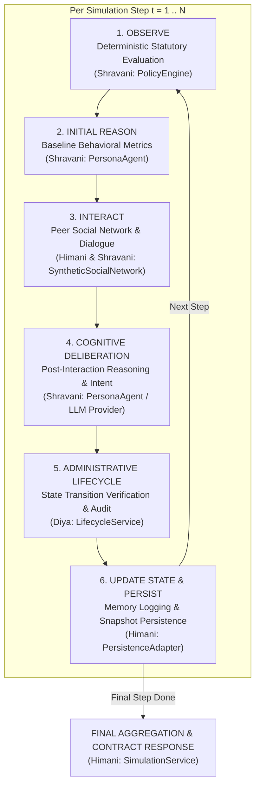

# Module Integration Contract & Technical Specification

**Author / Module Lead:** Himani (Simulation Engine + Technical Integration)
**Project:** Maharashtra Policy Simulator
**Scope:** Integration contract bridging synthetic population generation, deterministic policy evaluation, AI cognitive reasoning, social network diffusion, administrative application lifecycle, and relational database persistence.

---

## 1. Ownership Boundaries & Matrix

| Module | Module Owner | Primary Files / Components | Core Responsibilities & Boundaries |
| :--- | :--- | :--- | :--- |
| **Policy Engine** | **Shravani** | `simulation/policy_rules.py` | Statutory eligibility rules, attendance/income criteria, deterministic fee relief calculations. |
| **Cognitive Agent** | **Shravani** | `simulation/agent.py` | Behavioral utility metrics, cognitive prompt templates, LLM reasoning, peer dialogue generation. |
| **Database & Persistence** | **Diya** | `backend/database.py`, `backend/db_models.py` | SQLAlchemy 2.x DeclarativeBase, UTCDateTime, 12 production ORM entities, session managers. |
| **Application Lifecycle** | **Diya** | `backend/lifecycle_service.py` | Official application file management, state transitions (DRAFT $\to$ BENEFIT_DISBURSED), audit logging, approval guard. |
| **Population Generator** | **Vardayini** | `simulation/persona_generator.py`, `simulation/persona_schema.py`, `data/` | Grounded demographic generation, Dhule census distributions, persona instantiation. |
| **Scenarios & Analytics** | **Samayra** | `simulation/scenarios.py`, analytics modules | Counterfactual parameter variants, what-if scenarios, sensitivity analysis. |
| **Simulation Engine & Integration** | **Himani** | `simulation/engine.py`, `backend/service.py`, `backend/simulation_persistence.py` | Multi-step orchestration, social network coordination, lifecycle bridging, persistence adaptation, API DTO transformation. |

*Boundary Rule:* No teammate's core files are modified without explicit coordination. Interface integration occurs via non-invasive adapters and dependency injection.

---

## 2. End-to-End Simulation Execution Order

Each simulation run progresses sequentially through a 5-phase virtual step cycle:



### Phase Details

1. **Phase 1: OBSERVE (Statutory Evaluation)**
   - The engine passes each `StudentPersona` to `RajarshiShahuPolicyEngine.evaluate_eligibility()`.
   - Produces an immutable `PolicyEvaluationResult` containing boolean `is_eligible`, `estimated_fee_relief_inr`, and `failure_reasons`.
   - **Deterministic Authority:** Python policy rules are 100% authoritative; LLMs are never permitted to judge or hallucinate statutory eligibility.

2. **Phase 2: INITIAL REASON (Baseline Utility & Probabilities)**
   - `PersonaAgent.compute_baseline_metrics(policy_eval)` calculates:
     - `awareness_score`: $f(\text{initial\_awareness}, \text{digital\_literacy})$
     - `perceived_benefit_score`: $f(\text{fee\_relief}, \text{financial\_urgency}, \text{risk\_aversion})$
     - `application_probability`: Logistic threshold function based on benefit vs. hassle.
     - `completion_probability`: $f(\text{document\_readiness}, \text{diligence}, \text{institutional\_trust})$
     - `expected_uptake_probability`: $\text{is\_eligible} \times P(\text{apply}) \times P(\text{complete})$.

3. **Phase 3: INTERACT (Peer Diffusion Across Social Network)**
   - `SyntheticSocialNetwork` generates degree-bounded peer ties ($k \le 2$) anchored to homophily (taluka, institution, caste).
   - Active pairs converse on targeted topics (`SCHEME_AWARENESS`, `DOCUMENTATION_HURDLE`, `TRUST_AND_DISCOURAGEMENT`, `APPLICATION_GUIDANCE`).
   - Receiver's awareness and institutional trust dynamically increase/decrease via word-of-mouth diffusion.

4. **Phase 4: COGNITIVE DELIBERATION (AI Monologue & Stated Intention)**
   - Post-interaction metrics are recomputed.
   - Persona generates qualitative inner monologue and stated intention via `BaseLLMProvider`.
   - When offline or on failure, deterministic rule-grounded stub executes without network dependency.

5. **Phase 5: ADMINISTRATIVE LIFECYCLE INTEGRATION (Controlled 5-Step Progression)**
   - The behavioral desire to apply triggers the formal administrative pipeline in `backend/lifecycle_service.py` across distinct simulation steps, enforcing a **maximum of ONE administrative status transition per persona per simulation step**:
     - **Step 1 (Initiation):** Citizen intention triggers `create_application()` ($\to \text{DRAFT}$). Newly created files **must remain DRAFT for that step** (citizen state: `COLLECTING_DOCUMENTS`).
     - **Step 2 (Submission):** Citizen completes document gathering and invokes `submit_application()` ($\to \text{SUBMITTED}$, citizen state: `APPLIED`).
     - **Step 3 (Desk Scrutiny):** Verification officer commences scrutiny via `start_desk_scrutiny()` ($\to \text{UNDER\_VERIFICATION}$, citizen state: `APPLIED`).
     - **Step 4 (Statutory Evaluation & Sanction):** Verification officer conducts statutory evaluation via `record_eligibility_evaluation()`, and either approves via `approve_application()` ($\to \text{APPROVED}$) for eligible applicants or rejects via `reject_application()` ($\to \text{REJECTED}$) for ineligible applicants.
     - **Step 5 (Treasury Execution):** Following approval, the finance officer releases funds via `disburse_benefit()` ($\to \text{BENEFIT\_DISBURSED}$, citizen state: `BENEFIT_RECEIVED`).
   - **Crucial Separation:** Behavioral state `SimulationState` (e.g. `APPLIED`, `COLLECTING_DOCUMENTS`) reflects citizen psychology; administrative status `ApplicationLifecycleStatus` reflects the legal government file. A persona is only recorded as `BENEFIT_RECEIVED` once the lifecycle service formally confirms `BENEFIT_DISBURSED`. Multiple administrative transitions within a single step are strictly forbidden.

6. **Phase 6: TEMPORAL STATE UPDATE & PERSISTENCE**
   - In-memory persona state (`current_state`, `awareness`, `trust`, `memory_log`) updates.
   - If a database session is active, `SimulationPersistenceAdapter.record_step_snapshot()` commits temporal rows to `persona_run_states`, `persona_interactions`, and `aggregate_results`.

---

## 3. Module Interface Specifications

### 3.1 Population Generator Interface
- **Provider:** Vardayini (`simulation/persona_generator.py`)
- **Consumer:** Himani (`backend/service.py`)
- **Method Signature:**
  ```python
  generator = SyntheticPersonaGenerator(config=population_config, seed=seed)
  cohort: List[StudentPersona] = generator.generate_cohort(count=cohort_size, seed=seed)
  ```
- **Guaranteed Output:** List of `StudentPersona` dataclass instances with grounded demographic attributes (Dhule 2010-11 census baseline).

### 3.2 Statutory Policy Engine Interface
- **Provider:** Shravani (`simulation/policy_rules.py`)
- **Consumer:** Himani (`simulation/engine.py`)
- **Method Signature:**
  ```python
  result: PolicyEvaluationResult = RajarshiShahuPolicyEngine.evaluate_eligibility(
      persona: StudentPersona,
      assumed_reimbursement_rate: Optional[float] = 0.50
  )
  ```
- **Guaranteed Output:**
  ```python
  @dataclass
  class PolicyEvaluationResult:
      scheme_name: str
      is_eligible: bool
      failure_reasons: List[str]
      statutory_notes: List[str]
      reimbursement_percentage: float
      estimated_fee_relief_inr: float
      benefit_assumptions: List[str]
  ```

### 3.3 AI Cognitive Reasoning & LLM Provider Interface
- **Provider:** Shravani (`simulation/agent.py`)
- **Consumer:** Himani (`simulation/engine.py`)
- **Method Signature:**
  ```python
  agent = PersonaAgent(persona=persona, llm_provider=provider)
  metrics: PersonaCalculatedMetrics = agent.compute_baseline_metrics(policy_eval)
  reasoning: PersonaReasoningOutput = agent.reason(policy_eval, metrics)
  dialogue: InteractionRecord = sender_agent.interact_with(receiver, sender_eval, receiver_eval, topic, step_index)
  ```
- **Fallback Guarantee:** `StubLLMProvider` is 100% offline, deterministic, and safe. `GeminiLLMProvider` incorporates `fallback_to_stub=True` on network timeout, rate limit (HTTP 429), or missing API key.

### 3.4 Application Lifecycle Service Interface
- **Provider:** Diya (`backend/lifecycle_service.py`)
- **Consumer:** Himani (`simulation/engine.py`)
- **Key Methods:**
  ```python
  app = create_application(session, persona_id, policy_id, evaluation_policy_config_id, claimed_fee_relief_inr, is_eligible, ineligibility_reasons, run_id)
  app = submit_application(session, application_id, remarks)
  app = start_desk_scrutiny(session, application_id, remarks)
  eval_rec = record_eligibility_evaluation(session, application_id, evaluation_stage, is_eligible, policy_config_id, evaluated_by, failure_reasons, evaluation_notes)
  app = approve_application(session, application_id, remarks, approved_amount)
  app = disburse_benefit(session, application_id, disbursed_amount, payment_reference)
  app = reject_application(session, application_id, reason)
  ```
- **Enforced Constraints:**
  - `IneligibleApprovalViolationError`: Approval is strictly blocked if no prior pre-approval verification evaluation exists or if the latest evaluation determined the applicant is ineligible.
  - `InvalidLifecycleTransitionError`: Invalid state transitions (e.g. DRAFT $\to$ APPROVED directly) are raised and blocked.

### 3.5 Persistence Boundary & Transaction Ownership
- **Adapter:** Himani (`backend/simulation_persistence.py`)
- **Persistence Schema:** Diya (`backend/db_models.py`)
- **Key Methods:**
  ```python
  policy, config = SimulationPersistenceAdapter.ensure_policy_and_config(session, scheme_code="RCSMS-EBC")
  db_personas = SimulationPersistenceAdapter.sync_personas(session, personas)
  run_db = SimulationPersistenceAdapter.start_simulation_run(session, run_id, policy_id, policy_config_id, district, population_size, simulation_steps, seed)
  SimulationPersistenceAdapter.record_step_snapshot(session, run_id, step_number, personas, step_outputs, interactions, step_cohort)
  SimulationPersistenceAdapter.record_final_outcomes(session, run_id, individual_results)
  run_db = SimulationPersistenceAdapter.complete_simulation_run(session, run_id, final_cohort, status)
  ```
- **Transactional Authority Rule:**
  - The persistence adapter and orchestration engine execute `session.flush()` ONLY.
  - Neither adapter nor engine EVER calls `session.commit()`.
  - Transaction boundaries are strictly owned by the caller (e.g. `SimulationService` or test harness context manager `with get_db_session() as session:`).

---

## 4. Persona State Transfer Across Simulation Steps

Between step $t$ and step $t+1$, in-memory `StudentPersona` state evolves dynamically:

1. **Awareness Accumulation:**
   $$\text{awareness}_{t+1} = \min\left(1.0, \text{awareness}_t + \Delta_{\text{peer}} + \Delta_{\text{nudge}}\right)$$
2. **Institutional Trust Delta:**
   $$\text{trust}_{t+1} = \text{clamp}\left(0.0, 1.0, \text{trust}_t + \Delta_{\text{trust}}\right)$$
   Positive peer experiences boost trust; bureaucratic rejections or document delays reduce trust.
3. **Episodic Memory Buffer:**
   `persona.record_memory(step, event_type, details)` appends immutable records (`OBSERVE_POLICY`, `PEER_INTERACTION`, `REASON_OUTCOME`, `STATE_TRANSITION`, `STEP_CYCLE_COMPLETED`).
4. **Behavioral State Progression:**
   `UNINFORMED` $\to$ `AWARE` $\to$ `EVALUATING` $\to$ `COLLECTING_DOCUMENTS` $\to$ `APPLIED` $\to$ `BENEFIT_RECEIVED` (or `REJECTED` / `DROPPED_OUT`).

---

## 5. Backend API Data Contract (Response Expected by Frontend)

`SimulationResponse` (defined in `backend/models.py`) packages the unified multi-module output:

1. `metadata: SimulationMetadata`: Scheme code, name, district, cohort size, steps, seed, provider label, POC disclaimers.
2. `provenance_breakdown: ProvenanceBreakdown`: Classification of grounded reference fields, derived fields, synthetic behavioral priors, and POC assumptions.
3. `aggregate_metrics: AggregateMetrics`: Cohort eligibility count, uptake count, financial relief total/averages, mean probabilities.
4. `step_metrics: List[StepMetric]`: Temporal evolution of awareness, benefit, application probability, and peer interactions per step.
5. `network_topology: NetworkTopology`: Nodes, edges, max degree bound, and adjacency list.
6. `personas: List[PersonaOutput]`: Persona profiles, statutory status, awareness gain, trust delta, decision narrative, barriers, and monologue.
7. `interactions: List[InteractionRecordDTO]`: Dialogue transcripts, sender/receiver names, interaction topic, and state changes.

---

## 6. Known Gaps & Teammate Dependencies for Next Phases

1. **Taluka Assignment in Population Generator (Vardayini):**
   - `SyntheticPersonaDB.taluka` is `nullable=False`, while `StudentPersona` currently defaults `taluka` via fallback to `district`.
   - *Recommendation for Vardayini:* Ensure `StudentPersona` explicitly sets `taluka` from the Dhule taluka list (`Dhule`, `Shirpur`, `Sindkhede`, `Sakri`).
2. **Multi-District Expansion (Vardayini):**
   - Current implementation is grounded in Dhule district (2010-11 educational census). Expanding to other Maharashtra districts (e.g. Pune, Nanded, Gadchiroli) requires additional census adapters.
3. **What-If Scenario Exploration (Samayra):**
   - Integration hook `scenario_config_id` in `SimulationRunDB` is prepared and nullable. Samayra can inject policy scenario overrides into `SimulationRequest`.
4. **Dynamic Document Flaw Simulation (Diya & Shravani):**
   - The engine supports administrative `send_back_for_correction` and `resubmit_application`. Future phases can introduce specific document defect probabilities tied to cyber cafe vs. home digital application modes.
